# 10/6/2026

**PMA:**

```pseudocode
chan pedidos[3] (text, text, int);
chan resultados[C] (int);

Process Cliente[id: 0..C-1] {
    text sec1, sec2, prioridad;
    int resultado;
    while (true) {
        sec1 = ...;
        sec2 = ...;
        prioridad = ...;
        if (prioridad = ‘ALTA’) send pedidos[0] (sec1, sec2, id);
        else if (prioridad = ‘MEDIA’) send pedidos[1] (sec1, sec2, id);
        else send pedidos[2] (sec1, sec2, id);
        receive resultados[id] (resultado);
    }
}

Process Servidor {
    do (not empty pedidos[0]) →
        receive pedidos[0] (sec1, sec2, idAct);
        resultado = Analizar (sec1, sec2);
        send resultados[idAct] (resultado);
    [] (empty pedidos[0]) and (not empty pedidos[1]) →
        receive pedidos[1] (sec1, sec2, idAct);
        resultado = Analizar (sec1, sec2);
        send resultados[idAct] (resultado);
    [] (empty pedidos[0]) and (empty pedidos[1]) and (not empty pedidos[2]) →
        receive pedidos[2] (sec1, sec2, idAct);
        resultado = Analizar (sec1, sec2);
        send resultados[idAct] (resultado);
    [] (empty pedidos[0]) and (empty pedidos[1]) and (empty pedidos[2]) →
        delay (600);
    od
}
```

**ADA:**

```ada
procedure consultas is
    task type estudiante is
        entry identificar(id: IN integer);
        entry resultado(resultado: IN texto);
    end estudiante;
    estudiantes: array(1..E) of estudiante;

    task type docente;
    docentes: array(1..3) of docente;

    task coordinador is
        entry solicitud(consulta: IN texto; id: IN integer);
        entry libre(idE: OUT integer; cons: OUT texto);
    end coordinador;

    task body estudiante is
        consulta, res: texto;
        miId: integer;
    begin
        accept identificar(id: IN integer) do
            miId := id;
        end identificar;
        loop
            consulta := generarConsulta();
            coordinador.solicitud(consulta, miId);
            accept resultado(resultado: IN texto) do
                res := resultado;
            end resultado;
        end loop;
    end estudiante;

    task body coordinador is
    begin
        loop
            accept libre(idE: OUT integer; cons: OUT texto) do
                accept solicitud(consulta: IN texto; id: IN integer) do
                    idE := id;
                    cons := consulta;
                end solicitud;
            end libre;
        end loop;
    end coordinador;

    task body docente is
        idE: integer;
        consulta, resultado: texto;
    begin
        loop
            coordinador.libre(idE, consulta);
            resultado := Resolver(consulta);
            estudiantes(idE).resultado(resultado);
        end loop;
    end docente;
begin
    for i IN 1..E loop
        estudiantes(i).identificar(i);
    end loop;
end consultas;
```

# 18/6/2025

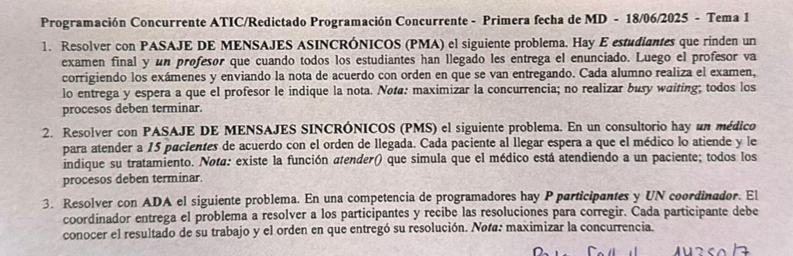

1)

```pseudocode
chan llegue (boolean);
chan enunciado (text);
chan corregir (int, text);
chan notas[E] (double);

Process Estudiante[id: 1..E] {
    text enun, resolucion;
    double miNota;
    send llegue (true);
    receive enunciado (enun);
    resolver (enun, resolucion);
    send corregir (id, resolucion);
    receive notas[id] (miNota);
}

Process Profesor {
    int i;
    boolean señal;
    text enun = ...;
    int idAct;
    text res;
    double notaAct;

    for i = 1..E {
        receive llegue (señal);
    }

    for i = 1..E {
        send llegue (enun);
    }

    for i = 1..E {
        receive corregir (idAct, res);
        calificar (res, notaAct);
        send notas[idAct] (notaAct);
    }
}
```

2)

```pseudocode
Process Medico {
    int i, idAct;
    text trat;
    for i = 1..15 {
        Admin!pedido ();
        Admin?aviso (idAct);
        Paciente[idAct]!pasar ();
        atender (idAct);
        trat = ...;
        Paciente[idAct]!tratamiento (trat);
    }
}

Process Admin {
    cola c;
    int llegaron = 0;
    int idAct;
    do (llegaron < 15); Paciente[*]?llegue (idAct) →
        push (c, idAct);
        llegaron++;
    [] (not empty c); Medico?pedido () →
        pop (idAct);
        Medico!aviso (idAct);
    od
}

Process Paciente[id: 1..15] {
    text trat;
    Admin!llegue (id);
    Medico?pasar ();
    // paciente siendo atendido
    Medico?tratamiento (trat);
}
```

3)

```ada
procedure Competencia is

    task type Participante is
        entry Identificar (id: IN Integer);
        entry RecibirNota (nota: IN Integer);
    end Participante;

    arrParticipantes: array (1..P) of Participante;

    task Coordinador is
        entry Entregar (id: IN Integer; resolucion: IN texto; orden: OUT Integer);
        entry Problema (data: OUT texto);
    end Coordinador;

    task body Participante is
        problema, resolucion: texto;
        resultado, orden: Integer;
        miId: Integer;
    begin
        accept Identificar (id: IN Integer) do
            miId := id;
        end Identificar;

        Coordinador.Problema (problema);
        resolver (problema, resolucion);

        Coordinador.Entregar (miId, resolucion, orden);

        accept RecibirNota (nota: IN Integer) do
            resultado := nota;
        end RecibirNota;
    end Participante;

    task body Coordinador is
        i: Integer;
        ordenAct: Integer := 1;
        problema: texto := ...;
        idAct, notaAct: Integer;
        resAct: texto;
    begin
        for i in 1..2*P loop
            SELECT
                accept Problema (data: OUT texto) do
                    data := problema;
                end Problema;
            OR
                accept Entregar (id: IN Integer; resolucion: IN texto; orden: OUT Integer) do
                    resAct := resolucion;
                    idAct := id;
                    orden := ordenAct;
                    ordenAct := ordenAct + 1;
                end Entregar;

                notaAct := calificar (resAct);

                arrParticipantes (idAct).RecibirNota (notaAct);

            END SELECT;
        end loop;
    end Coordinador;

begin
    for i in 1..P loop
        arrParticipantes (i).Identificar (i);
    end loop;
end Competencia;
```

# 4/11/2024

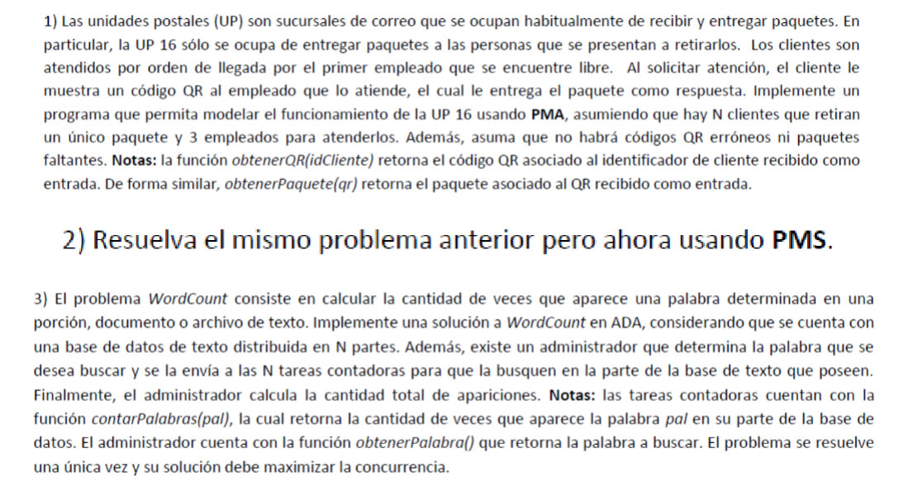

1)

```pseudocode
chan hayPedido (int, text);
chan esperaPaquete[N] (text);

Process Cliente [id: 0..N-1] {
    text paquete;
    text qr = ObtenerQR(id);

    send hayPedido(id, qr);
    receive esperaPaquete[id] (paquete);
}

Process Empleado [id: 0..2] {
    int idCliente;
    text qr, paquete;

    while (true) {
        receive hayPedido(idCliente, qr);
        paquete = ObtenerPaquete(qr);
        send esperaPaquete[idCliente] (paquete);
    }
}
```

2)

```pseudocode
Process Cliente [id: 0..N-1] {
    text paquete;
    text qr = ObtenerQR(id);

    Admin!pedido(id, qr);
    Empleado[*]?entrega_paquete(paquete);
}

Process Admin {
    Cola c;
    int llegados = 0;
    int idCli, idEmp, i;
    text qr;

    do (llegados < N); Cliente[*]?pedido(idCli, qr) →
        push(c, (idCli, qr));
        llegados++;
    [] (not empty c); Empleado[*]?libre(idEmp) →
        pop(c, (idCli, qr));
        Empleado[idEmp]!atender(idCli, qr);
    od
    for i = 0..2 {
        Empleado[*]?libre(idEmp);
        Empleado[idEmp]!atender(-1);
    }
}

Process Empleado [id: 0..2] {
    int idCli;
    text qr, paquete;
    boolean continuar = true;

    while (continuar) {
        Admin!libre(id);
        Admin?atender(idCli, qr);
        if (idCli != -1) {
            paquete = ObtenerPaquete(qr);
            Cliente[idCli]!entrega_paquete(paquete);
        } else {
            continuar = false;
        }
    }
}
```

3)

```ada
procedure WordCount is
task admin is
    entry buscar(palabra: OUT texto);
    entry cuenta(veces: IN integer);
end admin;

task type contador;

arrContadores: array(1..N) of contador;

task body contador is
    base: array(ini..fin) of texto := ...;
    pal: texto;
    cant: integer;
begin
    admin.buscar(pal);
    cant := contarPalabras(pal, base);
    admin.cuenta(cant);
end contador;

task body admin is
    pal: texto := obtenerPalabra();
    total: integer := 0;
    aux_res: integer;
begin
    for i in 1..2*N loop
        SELECT
            accept buscar(palabra: OUT texto) do
                palabra := pal;
            end buscar;
        OR WHEN (buscar.count = 0) =>
            accept cuenta(veces: IN integer) do
                aux_res := veces;
            end cuenta;
            total := total + aux_res;
        END SELECT;
    end loop;
end admin;
begin
    null;
end WordCount;
```

# 25/11/2024

1)

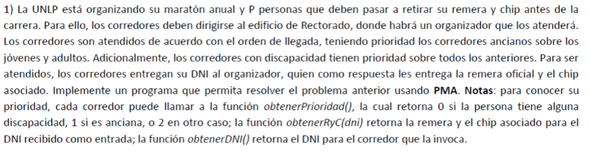

```pseudocode
chan colas[3](int, int);
chan llegue(boolean);
chan entrega[P](text, text);

Process Persona[id: 0..P-1] {
    int dni = obtenerDNI();
    int prioridad = obtenerPrioridad();
    send colas[prioridad](id, dni);
    send llegue(true);
    receive entrega[id](remera, chip);
}

Process Organizador {
    for i = 1..P {
        receive llegue(señal);
        if (not empty colas[0]) {
            receive colas[0](idAct, dniAct);
        } else if (not empty colas[1]) {
            receive colas[1](idAct, dniAct);
        } else {
            receive colas[2](idAct, dniAct);
        }
        (remera, chip) = obtenerRyC(dniAct);
        send entrega[idAct](remera, chip);
    }
}
```

2)

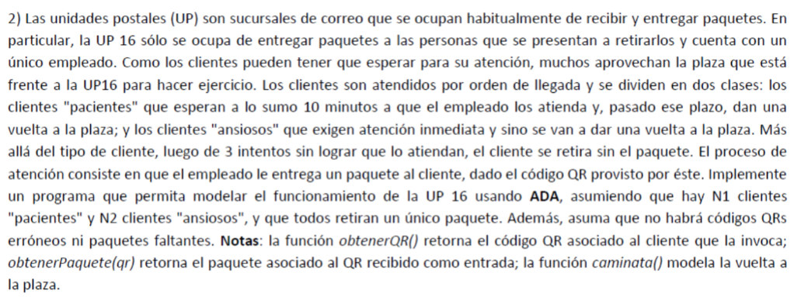

```ada
procedure UP16 is

    task type paciente;
    arrPacientes: array(1..N1) of paciente;

    task type ansioso;
    arrAnsiosos: array(1..N2) of ansioso;

    task empleado is
        entry pedido(qr: IN texto; paquete: OUT texto);
    end empleado;

    task body ansioso is
        intentos : integer := 3;
        pude     : boolean := false;
        qr       : texto := obtenerQR();
        paquete  : texto;
    begin
        while (not pude) and (intentos > 0) loop
            select
                empleado.pedido(qr, paquete);
                pude := true;
            else
                intentos := intentos - 1;
                if intentos > 0 then
                    caminata();
                end if;
            end select;
        end loop;
    end ansioso;

    task body paciente is
        intentos : integer := 3;
        pude     : boolean := false;
        qr       : texto := obtenerQR();
        paquete  : texto;
    begin
        while (not pude) and (intentos > 0) loop
            select
                empleado.pedido(qr, paquete);
                pude := true;
            or
                delay 600.0;
                intentos := intentos - 1;
                if intentos > 0 then
                    caminata();
                end if;
            end select;
        end loop;
    end paciente;

    task body empleado is
    begin
        loop
            accept pedido(qr: IN texto; paquete: OUT texto) do
                paquete := obtenerPaquete(qr);
            end pedido;
        end loop;
    end empleado;
begin
    null;
end UP16;
```

# 9/12/2024

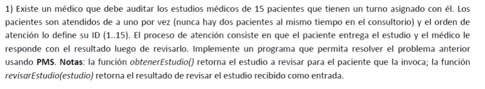

```pseudocode
Process Medico {
    int i;
    text estudioAct, resultado;

    for i = 1..15 {
        Paciente[i]?estudio(estudioAct);
        resultado = revisarEstudio(estudioAct);
        Paciente[i]!resultado(resultado);
    }
}

Process Paciente[id: 1..15] {
    text miResultado;
    text miEstudio = obtenerEstudio();

    Medico!estudio(miEstudio);
    Medico?resultado(miResultado);
}
```

# 13/11/2023

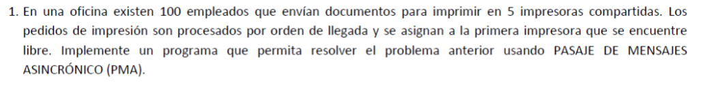

```pseudocode
chan documentos(text);
chan impresiones[100](text);

Process Empleado[id: 0..99] {
    text doc, impresion;
    while (true) {
        doc = ...;
        send documentos(doc, id);
        receive impresiones[id](impresion);
    }
}

Process Impresora[id: 0..4] {
    text docAct;
    int idAct;
    while (true) {
        receive documentos(docAct, idAct);
        send impresiones[idAct](imprimir(docAct));
    }
}
```

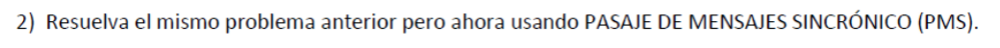

```pseudocode
Process Empleado[id: 0..99] {
    text doc, impresion;
    while (true) {
        doc = ...;
        Admin!documentos(doc, id);
        Impresora[*]?impresiones(impresion);
    }
}

Process Admin {
    int idImp, idEmp;
    text docAct;
    Cola c;

    do Empleado[*]?documentos(docAct, idEmp) →
        push(c, (docAct, idEmp));
    [] (not empty (c)); Impresora[*]?libre(idImp) →
        pop(c, (docAct, idEmp));
        Impresora[idImp]!siguiente(docAct, idEmp);
    od
}

Process Impresora[id: 0..4] {
    text docAct, idAct;
    while (true) {
        Admin!libre(id);
        Admin?siguiente(docAct, idAct);
        Empleado[idAct]!impresiones(imprimir(documento));
    }
}
```

# 26/6/2024

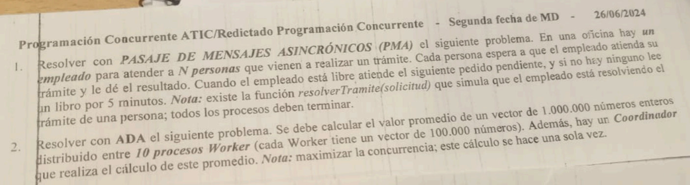

1)

```pseudocode
chan espera(int, text);
chan espera_resultado[N](text);

Process Empleado {
    int llegados = 0;
    text solicitud, resultado;
    int idAct;

    while (llegados < N) {
        if (not empty(espera)) {
            receive espera(idAct, solicitud);
            resolverTramite(solicitud, resultado);
            send espera_resultado[idAct](resultado);
            llegados++;
        } else {
            delay(300);
        }
    }
}

Process Persona[id: 0..N-1] {
    text solicitud = ...;
    text resultado;

    send espera(id, solicitud);
    receive espera_resultado[id](resultado);
}
```

2)

```ada
procedure promedio is
    task coordinador is
        entry cuenta(valor: IN integer);
    end coordinador;

    task type worker;
    arrWorkers: array(1..10) of worker;

    task body coordinador is
        valor_act: integer;
        total: integer := 0;
        prom: float;
    begin
        for i in 1..10 loop
            accept cuenta(valor: IN integer) do
                valor_act := valor;
            end cuenta;
            total := total + valor_act;
        end loop;
        prom := total / 1000000;
    end coordinador;

    task body worker is
        arr: array(1..100000) of nteger := InicializarVector;
        total: integer := 0;
    begin
        for i in 1..100000 loop
            total := total + arr(i);
        end loop;
        coordinador.cuenta(total);
    end worker;
begin
    null;
end promedio;
```

# 15/7/2021

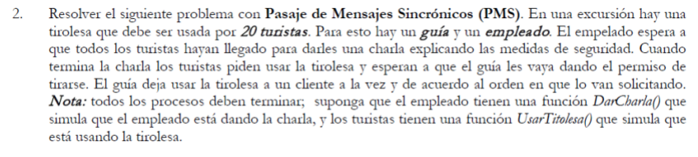

```pseudocode
Process Turista[id: 0..19] {
    Empleado!llegue();
    // esperando y escuchando charla
    Empleado?finCharla();
    Guia!pedirTirolesa(id);
    Guia?miTurno();
    UsarTirolesa();
    Guia!termine();
}

Process Guia {
    Cola c;
    boolean libre = true;
    int llegados = 0;
    int terminados = 0;

    do (llegados < 20); Turista[*]?pedirTirolesa(idAct) →
        llegados++;
        if (libre) {
            libre = false;
            Turista[idAct]!miTurno();
        } else {
            push(c, idAct);
        }
    [] (terminados < 20); Turista[*]?termine() →
        terminados++;
        if (empty (c)) {
            libre = true;
        } else {
            pop(c, idAct);
            Turista[idAct]!miTurno();
        }
    od
}

Process Empleado {
    int i;

    for i = 0..19 {
        Turista[*]?llegue();
    }
    DarCharla();
    for i = 0..19 {
        Turista[i]!finCharla();
    }
}
```

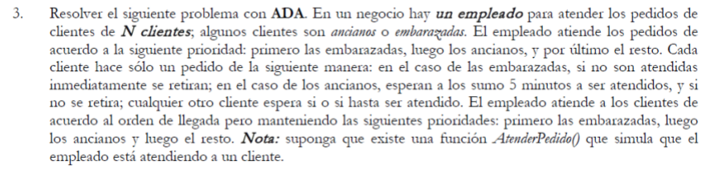

```ada
procedure negocio is
    task empleado is
        entry colaEmbarazadas(pedido: IN texto; devolucion: OUT texto);
        entry colaAncianos(pedido: IN texto; devolucion: OUT texto);
        entry colaOtros(pedido: IN texto; devolucion: OUT texto);
    end empleado;

    task type cliente;
    clientes: array(1..N) of cliente;

    task body cliente is
        tipo: Character := determinarTipo();
        pedido: texto := obtenerPedido();
        devolucion: texto;
    begin
        if (tipo = ‘E’) then
            SELECT
                empleado.colaEmbarazadas(pedido, devolucion);
            ELSE null;
            END SELECT;
        elsif (tipo = ‘A’) then
            SELECT
                empleado.colaAncianos(pedido, devolucion);
            OR delay(300)
                null;
            END SELECT;
        else
            empleado.colaOtros(pedido, devolucion);
        end if;
    end cliente;

    task body empleado is
    begin
        loop
            SELECT
                accept colaEmbarazadas(pedido: IN texto; devolucion: OUT texto) do
                    devolucion := AtenderPedido(pedido);
                end colaEmbarazadas;
            OR when(colaEmbarazadas’count = 0) =>
                accept colaAncianos(pedido: IN texto; devolucion: OUT texto) do
                    devolucion := AtenderPedido(pedido);
                end colaAncianos;
            OR when(colaEmbarazadas’count = 0) and (colaAncianos’count = 0) =>
                accept colaOtros(pedido: IN texto; devolucion: OUT texto) do
                    devolucion := AtenderPedido(pedido);
                end colaOtros;
            END SELECT;
        end loop;
    end empleado;
begin
    null;
end negocio;
```

# 1/7/2021

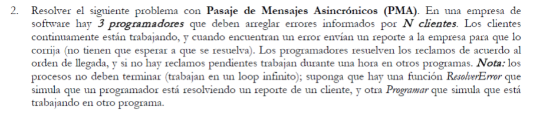

```pseudocode
chan reclamos(text);
chan libre(int);
chan siguiente[3](text);

Process Cliente[id: 0..N-1] {
    text reclamo;
    while (true) {
        reclamo = BuscarError();
        send reclamos(reclamo);
    }
}

Process Admin {
    int idEmp;
    text reclamoAct;
    while (true) {
        receive libre(idEmp);
        if (empty(reclamos)) {
            send siguiente[idEmp](“VACIO”);
        } else {
            receive reclamos(reclamoAct);
            send siguiente[idEmp](reclamoAct);
        }
    }
}

Process Programador[id: 0..2] {
    text reclamo;
    while (true) {
        send libre(id);
        receive siguiente[id](reclamo);
        if (reclamo == “VACIO”) {
            Programar(3600.0);
        } else {
            ResolverError(reclamo);
        }
    }
}
```

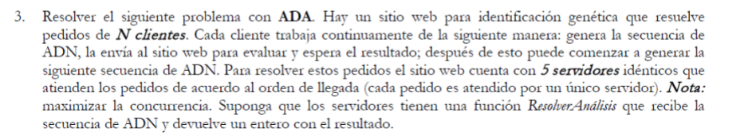

```ada
procedure sitioWeb is
    task type cliente is
        entry resultado(resultado: IN integer);
    end cliente;
    clientes: array(1..N) of clientes;

    task type servidor is
        entry resolver(secuencia: IN texto; resultado: OUT integer);
    end servidor;
    servidores: array(1..5) of servidor;

    task coordinador is
        entry solicitud(secuencia: IN texto; id: IN integer);
        entry libre(idC: OUT integer; sec: OUT texto);
    end coordinador;

    task body cliente is
        secuencia, res: texto;
    begin
        accept identificar(id: IN int) do
            miId := id;
        end identificar;
        loop
            secuencia := generarSecuencia();
            coordinador.solicitud(secuencia, miId);
            accept resultado(resultado: IN integer) do
                res := resultado;
            end resultado;
        end loop;
    end cliente;

    task body coordinador is
        idAct: integer;
    begin
        loop
            accept libre(idC: OUT integer; sec: OUT texto) do
                accept solicitud(secuencia: IN texto; id: IN integer) do
                    idC := id;
                    sec := secuencia;
                end solicitud;
            end libre;
        end loop;
    end coordinador;

    task body servidor is
        idC: integer;
    begin
        accept identificar(id: IN integer) do
            miId := id;
        end identificar;
        loop
            coordinador.libre(idC, secuencia);
            resultado := ResolverAnalisis(secuencia);
            clientes(idC).resultado(resultado);
        end loop;
    end servidor;
begin
    for i IN 1..5 loop
        servidores(i).identificar(i);
    end loop;
end sitioWeb;
```
