# RESUMEN PATRONES

**SEMÁFOROS: Barrera**

Un punto de sincronización donde un grupo de *N* procesos debe detenerse y esperar hasta que todos lleguen para continuar juntos.

```pseudocode
int cant = 0;
sem mutex = 1;
sem barrera = 0;

Process Worker[id: 0..N-1] {
    // Código previo
    P(mutex);
    cant++;
    if (cant == N) {
        for i = 1..N V(barrera); // El último en llegar despierta a todos [2]
    }
    V(mutex); // Se debe liberar SIEMPRE la SC antes de demorarse [1, 2]

    P(barrera);
    // Todos continúan su ejecución
}
```

**SEMÁFOROS: Productor / Consumidor (Buffer Limitado)**

Múltiples productores y consumidores acceden a un buffer compartido mediante "Contadores de Recursos" que indican los lugares ocupados y libres.

```pseudocode
typeT buf[N];
int ocupado = 0, libre = 0;
sem vacio = N, lleno = 0;   // Contadores de recursos [3]
sem mutexD = 1, mutexR = 1; // Exclusión mutua para operaciones múltiples [3]

Process Productor[i: 1..M] {
    while (true) {
        // Producir dato
        P(vacio); // Espera que haya al menos un lugar libre [3]
        P(mutexD);
        buf[libre] = dato;
        libre = (libre + 1) mod N;
        V(mutexD);
        V(lleno); // Avisa que hay un nuevo lugar ocupado [3]
    }
}

Process Consumidor[i: 1..K] {
    while (true) {
        P(lleno); // Espera que haya al menos un dato producido [3]
        P(mutexR);
        resultado = buf[ocupado];
        ocupado = (ocupado + 1) mod N;
        V(mutexR);
        V(vacio); // Avisa que se liberó un lugar [3]
        // Consumir resultado
    }
}
```

**SEMÁFOROS: Passing the Baton**

Mantiene el orden estricto de llegada a un recurso de una unidad transfiriendo el permiso directamente al proceso dormido sin modificar la variable de estado compartida para que no ocurran robos del recurso.

```pseudocode
Cola C;
sem mutex = 1, espera[N] = ([N] 0);
boolean libre = true;

Process Escalador[id: 0..N-1] {
    int idAux;

    // Protocolo de Entrada
    P(mutex);
    if (libre) {
        libre = false;
        V(mutex);
    } else {
        push(C, id);
        V(mutex);      // Libera la SC ANTES de irse a dormir [4, 6]
        P(espera[id]); // Se duerme en su semáforo privado [4, 6]
    }

    // Usa el recurso fuera de EM

    // Protocolo de Salida
    P(mutex);
    if (empty(C)) {
        libre = true;
    } else {
        pop(C, idAux);
        V(espera[idAux]); // Pasa el turno directamente sin poner libre=true [5, 6]
    }
    V(mutex);
}
```

**SEMÁFOROS: Varios procesos haciendo "N" cosas (Bolsa de Tareas/Caramelos)**

Varios workers consumen un recurso compartido (o ejecutan una tarea) iterativamente hasta alcanzar un límite *N*. La sección crítica se reduce al mínimo indispensable.

```pseudocode
int cant = 0;
sem mutex = 1;

Process Worker[id: 0..W-1] {
    while (cant < N) {
        P(mutex);
        if (cant < N) { // Rechequeo interno de la condición para evitar pasar el límite [8]
            cant = cant + 1;
            V(mutex); // Libero el mutex antes de procesar para maximizar concurrencia [7, 8]

            // Comer caramelo o procesar tarea

        } else {
            V(mutex); // Si ya se alcanzó el límite, simplemente libera y sale [8]
        }
    }
}
```

**MONITORES: Passing the Condition (Sin Coordinador)**

Esquema cliente-servidor directo donde los clientes gestionan el estado del recurso y respetan el orden pasando la condición explícitamente y utilizando un simple `if`.

```pseudocode
Monitor Cajero {
    bool libre = true;
    cond cola;
    int esperando = 0; // Se utiliza un entero para contabilizar los dormidos [9, 10]

    Procedure Pasar() {
        if (not libre) {
            esperando++;
            wait(cola); // Como es Passing the Condition, usa 'if' en lugar de 'while' [9, 10]
        } else {
            libre = false;
        }
    }

    Procedure Salir() {
        if (esperando > 0) {
            esperando--;
            signal(cola); // Despierta a un proceso y le pasa el cajero sin marcar 'libre = true' [9, 10]
        } else {
            libre = true;
        }
    }
}
```

**MONITORES: Passing the Condition (Con Coordinador / Administrador)**

Un monitor administra un grupo de recursos pasivos gestionando tanto a los clientes que solicitan el recurso como a los servidores que lo ofrecen.

```pseudocode
Monitor Banco {
    cola elibres;
    cond esperaC;
    int esperando = 0, cantLibres = 0;

    Procedure Llegada(idE: out int) {
        if (cantLibres == 0) {
            esperando++;
            wait(esperaC); // El cliente espera a que un empleado se libere [11, 12]
        } else {
            cantLibres--;
        }
        pop(elibres, idE); // Saca al empleado de la cola para que lo atienda [11, 12]
    }

    Procedure Proximo(idE: in int) {
        push(elibres, idE); // El empleado se encola indicando que está libre [11, 12]
        if (esperando > 0) {
            esperando--;
            signal(esperaC); // Pasa la condición al cliente dormido [11, 12]
        } else {
            cantLibres++;
        }
    }
}
```

**MONITORES: Prioridades (Shortest Job Next)**

Utilizado cuando los procesos no deben atenderse por orden de llegada sino por una prioridad temporal. Requiere una cola ordenada explícita y variables condición privadas.

```pseudocode
Monitor Shortest_Job_Next {
    bool libre = true;
    cond turno[N]; // Arreglo de variables condición privadas [13, 14]
    cola espera;

    Procedure request(int id, int tiempo) {
        if (libre) {
            libre = false;
        } else {
            insertar_ordenado(espera, id, tiempo); // Guarda en la estructura según prioridad [13, 14]
            wait(turno[id]); // Se duerme en su variable condición personal [13, 14]
        }
    }

    Procedure release() {
        if (empty(espera)) {
            libre = true;
        } else {
            sacar(espera, idAux); // Saca al proceso con el menor tiempo/mayor prioridad [13, 14]
            signal(turno[idAux]); // Lo despierta específicamente [13, 14]
        }
    }
}
```

**MONITORES: Barrera**

Un contador interno al monitor evalúa la cantidad de procesos; los primeros *N*−1 se duermen, y el último los despierta en cascada.

```pseudocode
Monitor Cancha {
    int cant = 0;
    cond espera;

    Procedure llegada() {
        cant++;
        if (cant < N) {
            wait(espera); // Los primeros N-1 procesos se duermen esperando en la barrera [15, 16]
        } else {
            signal_all(espera); // El último en llegar despierta de golpe a todos los demorados [15, 16]
        }
    }
}
```

# [1ra] 6/10/2025

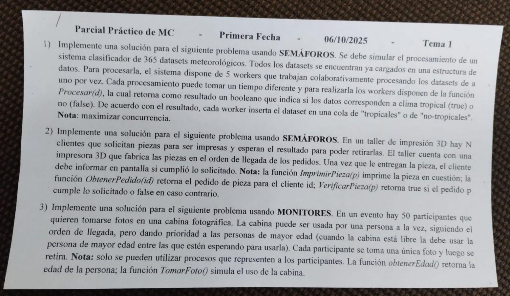

1.

```pseudocode
Cola datasets;
sem sDataset = 1;
Cola tropicales;
sem sTropicales = 1;
Cola no_tropicales;
sem sNoTrop = 1;

Process Worker[id: 1..5] {
    P(sDataset);
    while (!dataset.isEmpty()) {
        Dataset d = datasets.pop();
        V(sDataset);
        boolean tropical = Procesar(d);
        if (tropical) {
            P(sTropicales);
            tropicales.push(d);
            V(sTropicales);
        } else {
            P(sNoTrop);
            no_tropicales.push(d);
            V(sNoTrop);
        }
        P(sDataset);
    }
    V(sDataset);
}
```

2.

```pseudocode
Cola c;
sem sCola = 1;
sem llena = 0;
Pieza piezas[N];
sem piezas_listas ([N] 0);

Process Cliente[id: 1..N] {
    Pedido pedido = ObtenerPedido(id);
    P(sCola);
    c.push(pedido);
    V(sCola);
    V(llena);
    P(piezas_listas[id]);
    Pieza pieza = piezas[id];
    if (VerificarPieza(p)) {
        print('Cumplió lo solicitado');
    } else {
        print('No cumplió lo solicitado');
    }
}

Process Impresora {
    Pieza pieza;
    Pedido pedido;
    while (true) {
        P(llena);
        P(sCola);
        pedido = c.pop();
        V(sCola);
        pieza = ImprimirPieza(pedido);
        piezas[pedido.id] = pieza;
        V(piezas_listas[pedido.id]);
    }
}
```

3.

```pseudocode
Monitor Cabina {
    ColaOrdenada fila;
    boolean libre = true;
    cond espera[50];

    Procedure entrar(id: in int; edad: in int) {
        if (not libre) {
            fila.push(id, edad);
            wait(espera[id]);
        } else {
            libre = false;
        }
    }

    Procedure salir() {
        int idAux;
        if (not empty(fila)) {
            idAux = fila.pop();
            signal(espera[idAux]);
        } else {
            libre = true;
        }
    }
}

Process Participante[id: 0..49] {
    Cabina.entrar(id, ObtenerEdad());
    TomarFoto();
    Cabina.salir();
}
```

# [2da] 26/6/2024

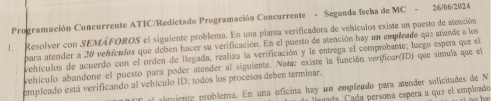

```pseudocode
Cola c;
sem sCola = 1;
sem llena = 0;
Comprobante comprobantes[20];
sem sComprobantes = ([20] 0);
sem libres = ([20] 0);

Process Vehiculo[id: 1..20] {
    P(sCola);
    c.push(id);
    V(sCola);
    V(llena);
    P(sComprobantes[id]);
    Comprobante com = comprobantes[id];
    V(libres[id]);
}

Process Empleado {
    int i;
    int id;
    Comprobante com;
    for i := 1..20 {
        P(llena);
        P(sCola);
        id = c.pop();
        V(sCola);
        com = verificar(id);
        comprobantes[id] = com;
        V(sComprobantes[id]);
        P(libres[id]);
    }
}
```

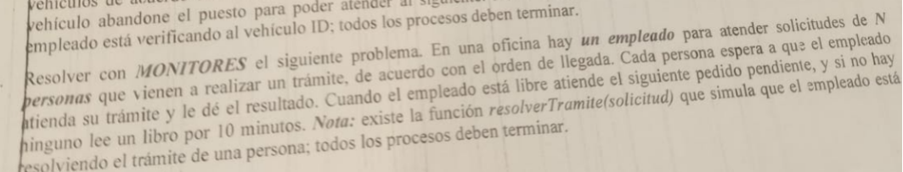

```pseudocode
Monitor Tramite {
    Cola fila;
    text solicitudes[N];
    text resultados[N];
    cond condPersonas[N];

    Procedure solicitar(id: in int; s: in text; resultado: out text) {
        fila.push(id);
        solicitudes[id] = s;
        wait(condPersonas[id]);
        resultado = resultados[id];
    }

    Procedure verificar(id: out int; s: out text; hayCliente: out boolean) {
        hayCliente = not fila.empty();
        if (hayCliente) {
            id = fila.pop();
            s = solicitudes[id];
        }
    }

    Procedure dar_resultado(idAct: in int; res: in text) {
        resultados[idAct] = res;
        signal(condPersonas[idAct]);
    }
}

Process Persona[id: 0..N-1] {
    text solicitud = ...;
    text resultado;
    Tramite.solicitar(id, solicitud, resultado);
}

Process Empleado {
    text solicitud;
    int idAct;
    text resultado;
    boolean hayCliente;
    int restantes = N;
    while (restantes > 0) {
        Tramite.verificar(idAct, solicitud, hayCliente);
        if (hayCliente) {
            resultado = resolverTramite(solicitud);
            Tramite.dar_resultado(idAct, resultado);
            restantes--;
        } else {
            delay(10);
        }
    }
}
```

# Noviembre 2024

1. **Resolver con SEMÁFOROS el siguiente problema. El CUIT es una clave que se utiliza en el sistema tributario de la República. Consta de un total de once (11) cifras numéricas, siendo la última un dígito verificador(del 0 al 9). Una empresa cuenta con una lista de CUITs qué sebe procesar, debiendo informar la cantidad de CUITs por dígito verificador. Para ello, dispone de un software que emplea 5 workers, los cuales trabajan colaborativamente procesando de a un CUIT por vez cada uno. Al finalizar el procesamiento, el último worker en terminar debe informar los resultados del procesamiento.**

   **NOTAS: la función obtenerDV(CUIT) retorna el dígito verificador para el CUIT recibido como entrada. La lista de CUITs se almacena como una cola global y la solución debe maximizar la concurrencia.**

```pseudocode
Cola c;
sem mutexC = 1;
sem mutexT = 1;
int digitos ([10] 0);
sem mutexD ([10] 1);
int terminados = 0;

Process Worker[id: 0..4] {
    int digActual;
    int CUITActual;
    boolean seguir = true;
    while (seguir) {
        P(mutexC);
        if (!c.empty()) {
            CUITActual = c.pop();
            V(mutexC);
            digActual = obtenerDV(CUITActual);
            P(mutexD[digActual]);
            digitos[digActual]++;
            V(mutexD[digActual]);
        } else {
            V(mutexC);
            seguir = false;
        }
    }
    P(mutexT);
    terminados++;
    if (terminados == 5) {
        println("Cantidad de CUITs por codigo verificador:");
        for int i = 0..9 {
            print("[" + i + "] = " + digitos[i] + " veces; ");
        }
    }
    V(mutexT);
}
```

2. **Resolver con MONITORES la siguiente situación. En un negocio hay UN empleado que diseña tarjetas digitales. El empleado debe atender los pedidos de C clientes, de acuerdo con el orden en que se hacen los pedidos. El cliente envía las indicaciones, y el empleado en base a eso diseña la tarjeta y se la envía al cliente.**

   **NOTAS: maximizar la concurrencia; existe una función hacerTarjeta(indicaciones) qué simula el armado de la tarjeta por parte del empleado; todos los procesos deben terminar su ejecución.**

```pseudocode
Monitor Negocio {
    Cola fila;
    text indClientes[C];
    cond emp;
    cond condClientes[C];
    Diseño diseños[C];

    Procedure pedir(id: in int; indicaciones: in text; diseño: out Diseño) {
        indClientes[id] = indicaciones;
        fila.push(id);
        signal(emp);
        wait(condClientes[id]);
        diseño = diseños[id];
    }

    Procedure siguiente(indicaciones: out text; idAct: out int) {
        while (fila.empty()) {
            wait(emp);
        }
        idAct = fila.pop();
        indicaciones = indClientes[idAct];
    }

    Procedure entregar(id: in int; d: in Diseño) {
        diseños[id] = d;
        signal(condClientes[id]);
    }
}

Process Cliente[id: 0..C-1] {
    text indicaciones = ...;
    Diseño diseño;
    Negocio.pedir(id, indicaciones, diseño);
}

Process Empleado {
    Diseño d;
    text indicaciones;
    int idAct;
    for int i = 1..C {
        Negocio.siguiente(indicaciones, idAct);
        d = hacerTarjeta(indicaciones);
        Negocio.entregar(idAct, d);
    }
}
```

# [1ra] 14/5/2025 T1

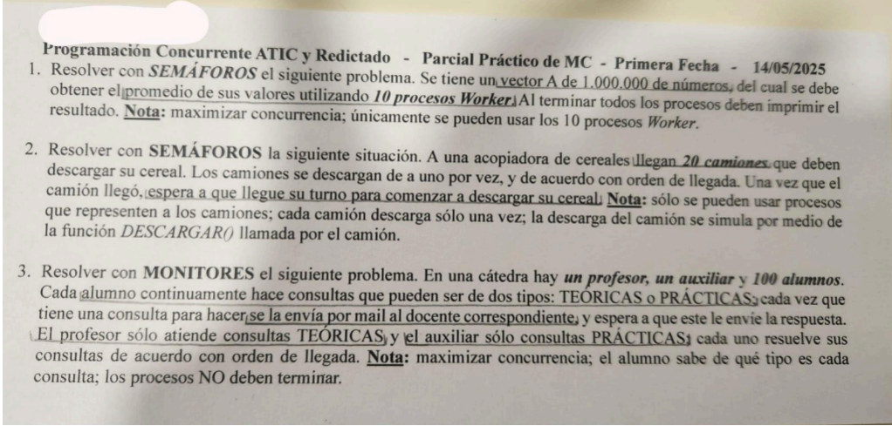

1.

```pseudocode
int A[1000000];
int cantXWorker = 1000000 DIV 10;
int sumaTotal = 0;
sem semSuma = 1;
sem mutex = 1;
sem barrera = 0;

Process Worker[id: 0..9] {
    int ini = id * cantXWorker;
    int fin = ini + cantXWorker - 1;
    int suma = 0;
    for int i = ini..fin {
        suma += A[i];
    }
    P(semSuma);
    sumaTotal += suma;
    V(semSuma);
    P(mutex);
    cant++;
    if (cant == 10) {
        for i = 0..9 V(barrera);
    }
    V(mutex)
    P(barrera);
    print(sumaTotal / 10);
}
```

2.

```pseudocode
Cola fila;
sem espera = ([20] 0);
sem mutex = 1;
boolean libre = true;

Process Camion[id: 0..19] {
    int idAux;
    P(mutex);
    if (not libre) {
        fila.push(id);
        V(mutex);
        P(espera[id]);
    } else {
        libre = false;
        V(mutex);
    }
    Descarga();
    P(mutex);
    if (fila.isEmpty()) {
        libre = true;
    } else {
        idAux = fila.pop();
        V(espera[idAux]);
    }
    V(mutex);
}
```

3.

```pseudocode
Monitor Consultas[id: 0..1] {
    Cola cola_consultas;
    text consultas[100];
    cond docente;
    cond espera_respuesta[100];
    text respuestas[100];

    Procedure consultar(id: in int; consulta: in text; respuesta: out text) {
        cola_consultas.push(id);
        consultas[id] = consulta;
        signal(docente);
        wait(espera_respuesta[id]);
        respuesta = respuestas[id];
    }

    Procedure recibir(id: out int; consulta: out text) {
        while (cola_consultas.isEmpty()) {
            wait(docente);
        }
        id = cola_consultas.pop();
        consulta = consultas[id];
    }

    Procedure responder(id: in int; respuesta: in text) {
        respuestas[id] = respuesta;
        signal(espera_respuesta[id]);
    }
}

Process Alumno[id: 0..99] {
    text consulta, respuesta;
    while (true) {
        consulta = ...;
        if (consulta.esTeorica) {
            Consultas[0].consultar(id, consulta, respuesta);
        } else {
            Consultas[1].consultar(id, consulta, respuesta);
        }
    }
}

Process Profesor {
    text consulta, respuesta;
    int idAux;
    while (true) {
        Consultas[0].recibir(idAux, consulta);
        // solucionando consulta
        Consultas[0].responder(idAux, respuesta);
    }
}

Process Auxiliar {
    text consulta, respuesta;
    int idAux;
    while (true) {
        Consultas[1].recibir(idAux, consulta);
        // solucionando consulta
        Consultas[1].responder(idAux, respuesta);
    }
}
```

# [1ra] 14/5/2025 T2

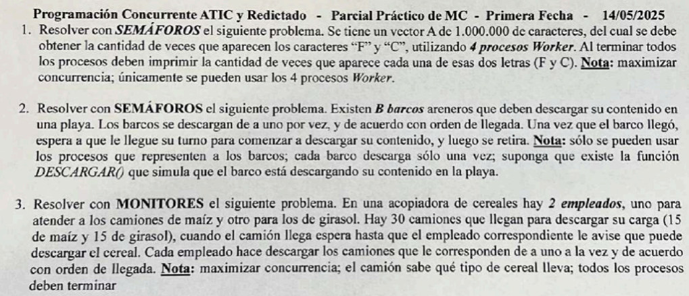

1.

```pseudocode
char A[1000000];
int totalF = 0;
int totalC = 0;
int cantXWorker = 1000000 DIV 4;
sem semTotal = 1;
sem barrera = 0;
int restantes = 4;

Process Worker[id: 0..3] {
    int i;
    int ini = id * cantXWorker;
    int fin = ini + cantXWorker - 1;
    int F = 0;
    int C = 0;
    for i = ini..fin {
        if (A[i] == 'F') {
            F++;
        } else if (A[i] == 'C') {
            C++;
        }
    }
    P(semTotal);
    totalF += F;
    totalC += C;
    restantes--;
    if (restantes == 0) {
        for i = 0..3 V(barrera);
    }
    V(semTotal);
    P(barrera);
    print(totalF, totalC);
}
```

2.

```pseudocode
Cola fila;
boolean libre = true;
sem mutex = 1;
sem espera = ([B] 0);

Process Barco[id: 0..B-1] {
    int idAct;
    P(mutex);
    if (not libre) {
        fila.push(id);
        V(mutex);
        P(espera[id]);
    } else {
        libre = false;
        V(mutex);
    }
    Descargar();
    P(mutex);
    if (fila.isEmpty()) {
        libre = true;
    } else {
        idAct = fila.pop();
        V(espera[idAct]);
    }
    V(mutex);
}
```

3.

```pseudocode
Monitor Acopiadora[id: 0..1] {
    cond emp;
    cond espera;
    cond emp_termino;
    int esperando = 0;

    Procedure solicitar_descarga() {
        esperando++;
        signal(emp);
        wait(espera);
    }

    Procedure habilitar_descarga() {
        if (esperando == 0) {
            wait(emp);
        }
        esperando--;
        signal(espera);
        wait(emp_termino);
    }

    Procedure salir() {
        signal(emp_termino);
    }
}

Process Camion[id: 0..29] {
    text tipoDescarga = ...;
    if (tipoDescarga = "Maíz") {
        Acopiadora[0].solicitar_descarga();
        // descargando
        Acopiadora[0].salir();
    } else if (tipoDescarga = "Girasol") {
        Acopiadora[1].solicitar_descarga();
        // descargando
        Acopiadora[1].salir();
    }
}

Process EmpMaiz {
    int i;
    for i = 1..15 {
        Acopiadora[0].habilitar_descarga();
    }
}

Process EmpGirasol {
    int i;
    for i = 1..15 {
        Acopiadora[1].habilitar_descarga();
    }
}
```

# [1ra] 14/5/2025 T3

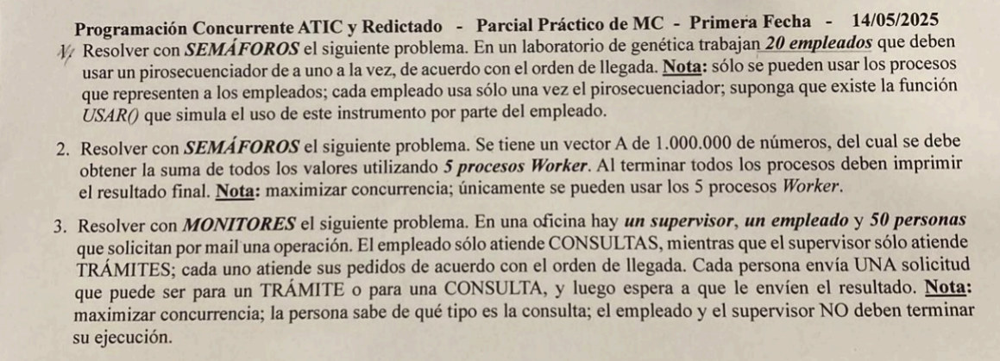

1.

```pseudocode
Cola fila;
boolean libre = true;
sem mutex = 1;
sem espera = ([20] 0)

Process Empleado[id: 0..19] {
    int idAct;
    P(mutex);
    if (not libre) {
        fila.push(id);
        V(mutex);
        P(espera[id]);
    } else {
        libre = false;
        V(mutex);
    }
    USAR();
    P(mutex);
    if (fila.isEmpty) {
        libre = true;
    } else {
        idAct = fila.pop();
        V(espera[idAct]);
    }
    V(mutex);
}
```

2.

```pseudocode
int restantes = 5;
int cantXWorker = 1000000 DIV 5;
int A[1000000];
sem mutex = 1;
sem barrera = 0;
int total = 0;

Process Worker[id: 0..4] {
    int i;
    int ini = id * cantXWorker;
    int fin = ini + cantXWorker - 1;
    int suma = 0;
    for i = ini..fin {
        suma += A[i];
    }
    P(mutex);
    total += suma;
    restantes--;
    if (restantes == 0) {
        for i = 0..4 V(barrera);
    }
    V(mutex);
    P(barrera);
    print(total);
}
```

3.

```pseudocode
Monitor Oficina {
    Cola consultas;
    Cola tramites;
    cond espera[2];
    cond oficinista[2];
    text resultados[50];

    Procedure solicitar(id: in int; tipoConsulta: in int; resultado: out text) {
        if (tipoConsulta == 0) {
            consultas.push(id);
            signal(oficinista[0]);
            wait(espera[0]);
        } else {
            tramites.push(id);
            signal(oficinista[1]);
            wait(espera[1]);
        }
        resultado = resultados[id];
    }

    Procedure recibir(id: in int; idAux: out int) {
        if (id == 0) {
            while (consultas.isEmpty()) {
                wait(oficinista[0]);
            }
            idAux = consultas.pop();
        } else if (id == 1) {
            while (tramites.isEmpty()) {
                wait(oficinista[1]);
            }
            idAux = tramites.pop();
        }
    }

    Procedure resolver(id: in int; resultado: in text; tipoConsulta: in int) {
        resultados[id] = resultado;
        signal(espera[tipoConsulta]);
    }
}

Process Persona[id: 0..49] {
    int tipoConsulta = ...; // 0 para Consulta y 1 para Trámite
    text resultado;
    Oficina.solicitar(id, tipoConsulta, resultado);
}

Process Oficinista[id: 0..1] {
    text resultado;
    int idAux;
    int tipoConsulta;
    while (true) {
        Oficina.recibir(id, idAux, tipoConsulta);
        // resolviendo consulta...
        resultado = ...;
        Oficina.resolver(idAux, resultado, tipoConsulta);
    }
}
```

# [1ra] 7/10/2024

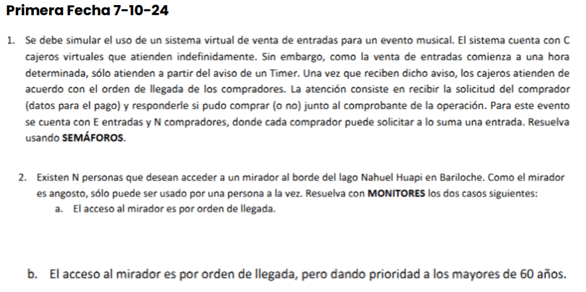

1.

```pseudocode
Cola fila;
sem mutexFila = 1;
sem mutexE = 1;
sem barrera = 0;
sem hayCliente = 0;
text comprobantes[N];
int entradasRestantes = E;
boolean pudoComprar = ([N] false);
sem espera = ([N] 0);

Process Timer {
    delay(tiempo);
    for int i = 1..C {
        V(barrera);
    }
}

Process Cajero[id: 0..C-1] {
    int idAux;
    text datosPago;
    text comprobante;
    boolean hayEntrada;
    P(barrera);
    while (true) {
        hayEntrada = false;
        P(hayCliente);
        P(mutexFila);
        pop(fila, idAux, datosPago);
        V(mutexFila);
        if (validarDatosPago(datosPago)) {
            P(mutexE);
            if (entradasRestantes > 0) {
                entradasRestantes--;
                hayEntrada = true;
            }
            V(mutexE);
            if (hayEntrada) {
                comprobante = ...;
                comprobantes[idAux] = comprobante;
                pudoComprar[idAux] = true;
            }
        }
        V(espera[idAux]);
    }
}

Process Comprador[id: 0..N-1] {
    text datosPago = ...;
    boolean pudeComprar;
    text comprobante;
    P(mutexFila);
    push(fila, id, datosPago);
    V(mutexFila);
    V(hayCliente);
    P(espera[id]);
    pudeComprar = pudoComprar[id];
    if (pudeComprar)
        comprobante = comprobantes[id];
}
```

2.

   1.

```pseudocode
Monitor Mirador {
    boolean libre = true;
    int esperando = 0;
    cond fila;

    Procedure entrar() {
        if (not libre) {
            esperando++;
            wait(fila);
        } else {
            libre = false;
        }
    }

    Procedure salir() {
        if (esperando > 0) {
            esperando--;
            signal(fila);
        } else {
            libre = true;
        }
    }
}

Process Persona[id: 0..N-1] {
    Mirador.entrar();
    // mirando el paisaje
    Mirador.salir();
}
```

   2.

```pseudocode
Monitor Mirador {
    boolean libre = true;
    cond turno[N];
    ColaOrdenada fila;

    Procedure entrar(id: in int; edad: in int) {
        if (libre) {
            libre = false;
        } else {
            insertar_ordenado(fila, id, edad);
            wait(turno[id]);
        }
    }

    Procedure salir() {
        int idAux;
        if (empty(fila)) {
            libre = true;
        } else {
            sacar(fila, idAux);
            signal(turno[idAux]);
        }
    }
}

Process Persona[id: 0..N-1] {
    int edad = ...;
    Mirador.entrar(id, edad);
    // mirando el paisaje
    Mirador.salir();
}
```

# [2da] 25/11/2024

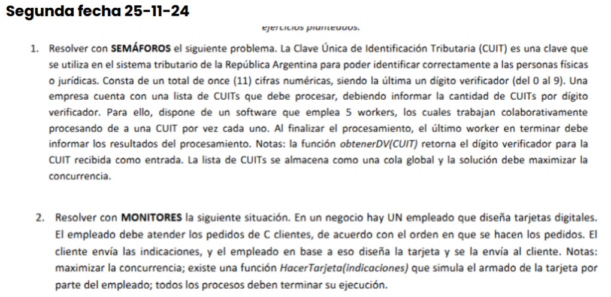

1.

```pseudocode
Cola CUITS;
sem mutex = 1;
int termine = 0;
int cantCUITS = ([10] 0);
sem mutexVector = ([10] 1);
sem semTermine = 1;

Process Worker[id: 0..4] {
    int cuitAct, digAct, i;
    P(mutex);
    while (not empty CUITS) {
        pop(CUITS, cuitAct);
        V(mutex);
        digAct = obtenerDV(cuitAct);
        P(mutexVector[digAct]);
        cantCUITS[digAct]++;
        V(mutexVector[digAct]);
        P(mutex);
    }
    V(mutex);
    P(semTermine);
    termine++;
    if (termine == 5) {
        for i = 0..9 {
            println(cantCUITS[i]);
        }
    }
    V(semTermine);
}
```

2.

```pseudocode
Monitor Diseños {
    Cola fila;
    cond emp;
    cond espera;
    Tarjeta tarjetas[C];

    Procedure solicitar(id: in int; indicaciones: in text; tarjeta: out Tarjeta) {
        push(fila, id, indicaciones);
        signal(emp);
        wait(espera);
        tarjeta = tarjetas[id];
    }

    Procedure realizar(id: out int; indicaciones: out text) {
        if (empty fila) {
            wait(emp);
        }
        pop(fila, id, indicaciones);
    }

    Procedure entregar(id: in int; t: in Tarjeta) {
        tarjetas[id] = t;
        signal(espera);
    }
}

Process Cliente[id: 0..C-1] {
    text indicaciones = ...;
    Tarjeta tarjeta;
    Diseños.solicitar(id, indicaciones, tarjeta);
}

Process Empleado {
    int i;
    Tarjeta t;
    int idAct;
    text indicaciones;
    for i = 1..C {
        Diseños.realizar(idAct, indicaciones);
        t = HacerTarjeta(indicaciones);
        Diseños.entregar(idAct, t);
    }
}
```

# [3ra] 9/12/2024

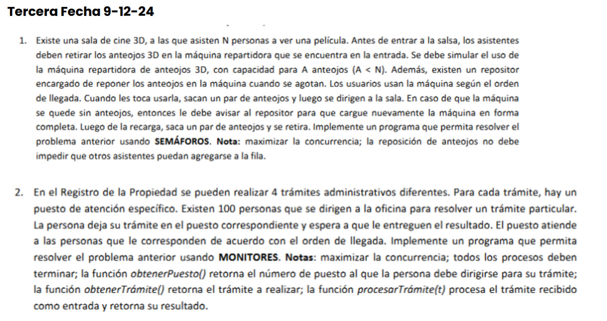

1.

```pseudocode
sem reponer = 0;
sem espera = ([N] 0);
sem mutex = 1;
sem hayAnteojos = 0;
Cola fila;
boolean libre = true;
int anteojos = A;

Process Persona[id: 0..N-1] {
    int idAux;
    P(mutex);
    if (libre) {
        libre = false;
        V(mutex);
    } else {
        push(fila, id);
        V(mutex);
        P(espera[id]);
    }
    if (anteojos == 0) {
        V(reponer);
        P(hayAnteojos);
    }
    anteojos--;
    P(mutex);
    if (empty fila) {
        libre = true;
    } else {
        pop(fila, idAux);
        V(espera[idAux]);
    }
    V(mutex);
}

Process Repositor {}
    while (true) {
        P(reponer);
        anteojos = A;
        V(hayAnteojos);
    }
}
```

2.

```pseudocode
Monitor RegProp[id: 0..3] {
    cond espera;

    Procedure entrar(t: in Tramite; resultado: out text) {

    }
}

Process Persona[id: 0..99] {
    text resultado;
    int puesto = obtenerPuesto();
    Tramite t = obtenerTramite();
    RegProp[puesto].entrar(id, t);
    // esperando resultado
    RegProp[puesto].salir(resultado);
}

Process Empleado[id: 0..3] {

}
```

# [1ra] 3/5/2023

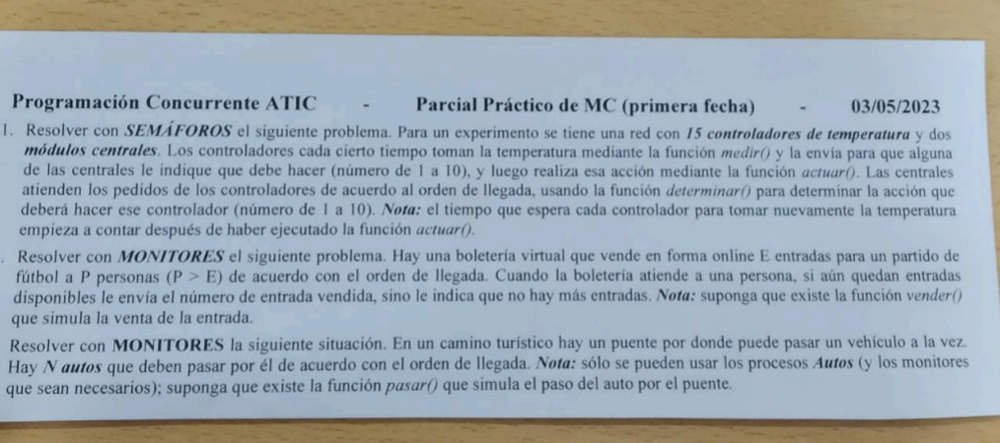

1.

```pseudocode
sem mutex = 1;
Cola c;
sem esperar_accion = ([15] 0);
int acciones[15];
sem hayPedido = 0;

Process Controlador[id: 0..14] {
    double temp;
    int queHacer;
    while (true) {
        temp = medir();
        P(mutex);
        push(c, id, temp);
        V(mutex);
        V(hayPedido);
        P(esperar_accion[id]);
        queHacer = acciones[id];
        actuar(queHacer);
        delay(tiempoEspera);
    }
}

Process ModuloCentral[id: 0..1] {
    int idAct;
    double tempAct;
    int queHacer;
    while (true) {
        P(hayPedido);
        P(mutex);
        pop(c, idAct, tempAct);
        V(mutex);
        queHacer = determinar(tempAct);
        acciones[idAct] = queHacer;
        V(esperar_accion[idAct]);
    }
}
```

2.

```pseudocode
Monitor Boleteria {
    int entradas = E;
    Cola fila;

    Procedure comprar(idAct: in int; nroEntrada: out int) {

    }
}

Process Persona[id: 0..P-1] {
    int nroEntrada;
    Boleteria.comprar(id, nroEntrada);
}

Process Vendedor {
    while (true) {
        Boleteria.atender();

    }
}
```

# [1ra] 8/2021

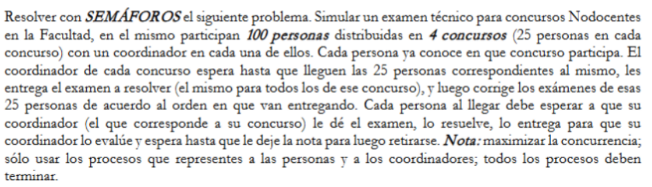

```pseudocode
int cantXConcurso = ([4] 0);
sem mutexConcurso = ([4] 1);
sem empezar = ([4] 0);
sem llegaronTodos = ([4] 0);
text examenes[4];
Cola filas[4];
sem hayExamen = ([4] 0);
double notas[100];
sem hayNota = ([100] 0);
sem mutexCola = ([4] 1);

Process Persona[id: 0..99] {
    int miConcurso = ...;
    P(mutexConcurso[miConcurso]);
    cantXConcurso[miConcurso]++;
    if (cantXConcurso[miConcurso] == 25) {
        V(llegaronTodos[miConcurso]);
    }
    V(mutexConcurso[miConcurso]);
    P(empezar[miConcurso]);
    text miExamen = examenes[miConcurso];
    // resolviendo examen
    P(mutexCola[miConcurso]);
    push(filas[miConcurso], id, miExamen);
    V(mutexCola[miConcurso]);
    V(hayExamen[miConcurso]);
    P(hayNota[id]);
    double nota = notas[id];
}

Process Coordinador[id: 0..3] {
    int i, idAct;
    text examenAct;
    P(llegaronTodos[id]);
    text examen = ...;
    examenes[id] = examen;
    for i = 1..25 {
        V(empezar[id]);
    }
    for i = 1..25 {
        P(hayExamen[id]);
        P(mutexCola[id]);
        pop(filas[id], idAct, examenAct);
        V(mutexCola[id]);
        double notaAct = corregir(examenAct);
        notas[idAct] = notaAct;
        V(hayNota[idAct]);
    }
}
```

# [2da] 25/11/2021

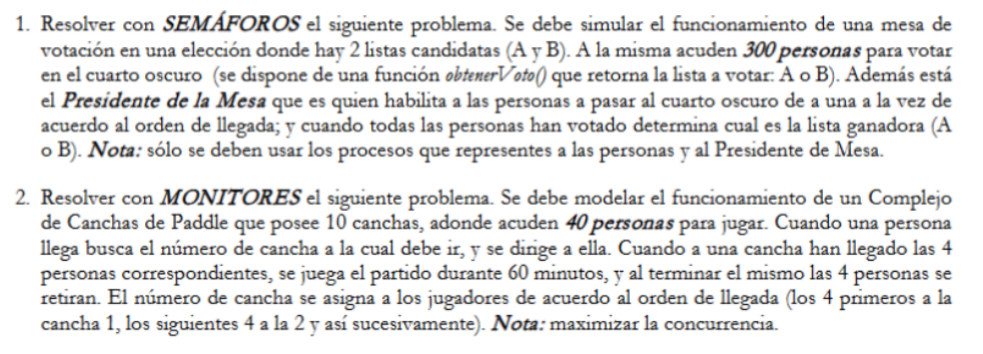

# [S] Examen final

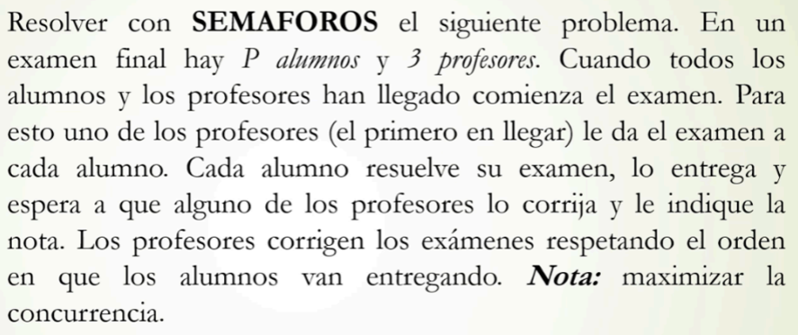

```pseudocode
int aRestantes = P;
int pRestantes = 3;
int TOTAL = aRestantes + pRestantes;
sem pMutex = 1;
sem mutex = 1;
sem barrera = 0;
sem semExamen = 0;
text examen;
double notas[P];
Cola examenes;
sem mutexCola = 1;
sem semNotas = ([P] 0);
sem alguienEntrego = 0;

Process Alumno[id: 0..P-1] {
    int i;
    P(mutex);
    aRestantes--;
    if (aRestantes + pRestantes == 0) {
        for i = 1..TOTAL {
            V(barrera);
        }
    }
    V(mutex);
    P(barrera);
    P(semExamen);
    text miExamen = examen;
    Resolver(miExamen);
    P(mutexCola);
    push(examenes, id, miExamen);
    V(mutexCola);
    V(alguienEntrego);
    P(semNotas[id]);
}

Process Profesor[id: 0..2] {
    int i, idAct;
    text examenAct;
    double nota;
    boolean entregarExamen = false;
    boolean seguir = true;
    P(pMutex);
    if (pRestantes == 3) entregarExamen = true;
    V(pMutex);
    P(mutex);
    pRestantes--;
    if (aRestantes + pRestantes == 0) {
        for i = 1..TOTAL {
            V(barrera);
        }
    }
    V(mutex);
    P(barrera);
    if (entregarExamen) {
        aRestantes = P;
        examen = ...; // asumiendo mismo examen para todos
        for i = 1..P {
            V(semExamen);
        }
    }
    while (seguir) {
        P(alguienEntrego);
        P(mutexCola);
        if (aRestantes > 0) {
            pop(examenes, idAct, examenAct);
            aRestantes--;
            if (aRestantes == 0) {
                V(alguienEntrego);
                V(alguienEntrego);
            }
            V(mutexCola);
            nota = Corregir(examenAct);
            notas[idAct] = nota;
            V(semNotas[idAct]);
        } else {
            seguir = false;
            V(mutexCola);
        }
    }
}
```

# [S] Competencia culinaria

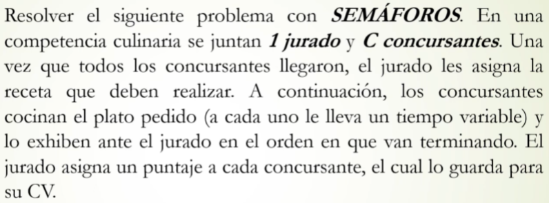

```pseudocode
sem mutex = 1;
int cant = 0;
sem barrera = 0;
sem jurado = 0;
sem esperar_receta = ([C] 0);
sem esperar_puntaje = ([C] 0);
double puntajes[C];
Receta recetas[C];
Cola fila;
sem presentar_plato = 0;

Process Concursante[id: 0..C-1] {
    int i;
    P(mutex);
    cant++;
    if (cant < C) {
        V(mutex);
        P(barrera);
    } else {
        V(mutex);
        for i = 1..C-1 { V(barrera); }
        V(jurado);
    }
    P(esperar_receta[id]);
    Receta r = recetas[id];
    Plato p = r.cocinar();
    P(mutex);
    push(fila, id, p);
    V(mutex);
    V(presentar_plato);
    P(esperar_puntaje[id]);
    guardarEnCV(puntajes[id]);
}

Process Jurado {
    int i, idAct;
    Plato platoAct;
    P(jurado);
    for i = 0..C-1 {
        recetas[i] = asignarReceta();
        V(esperar_receta[i]);
    }
    for i = 0..C-1 {
        P(presentar_plato);
        P(mutex);
        pop(fila, idAct, platoAct);
        V(mutex);
        puntajes[idAct] = platoAct.puntuar();
    }
}
```

# [S] Médico clínico

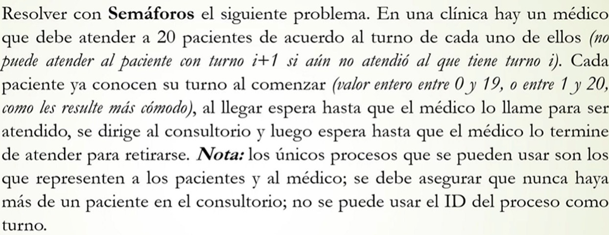

```pseudocode
sem llamar = ([20] 0);
sem pasar = 0;
sem salir = 0;
sem consultorio_libre = 0;

Process Paciente[id: 0..19] {
    int miTurno = ...;
    P(llamar[miTurno]);
    V(pasar);
    P(salir);
    V(consultorio_libre);
}

Process Medico {
    int i, turnoAct;
    for i = 0..19 {
        V(llamar[i]);
        P(pasar);
        // atendiendo
        V(salir);
        P(consultorio_libre);
    }
}
```

# [S] Máquina expendedora de agua

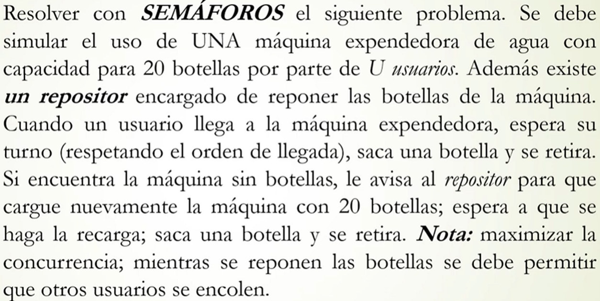

```pseudocode
Cola fila;
sem mutex = 1;
int cantBotellas = ...;
sem recargar = 0;
sem recargado = 0;
boolean libre = true;
sem espera = ([U] 0)

Process Usuario[id: 0..U-1] {
    int idAux;
    P(mutex);
    if (libre) {
        libre = false;
        V(mutex);
    } else {
        push(fila, id);
        V(mutex);
        P(espera[id]);
    }
    if (cantBotellas == 0) {
        V(recargar);
        P(recargado);
    }
    // tomar botella
    cantBotellas--;
    P(mutex);
    if (empty fila) {
        libre = true;
    } else {
        pop(fila, idAux);
        V(espera[idAux]);
    }
    V(mutex);
}

Process Repositor {
    while (true) {
        P(recargar);
        cantBotellas = 20;
        V(recargado);
    }
}
```

# [M] Salita médica

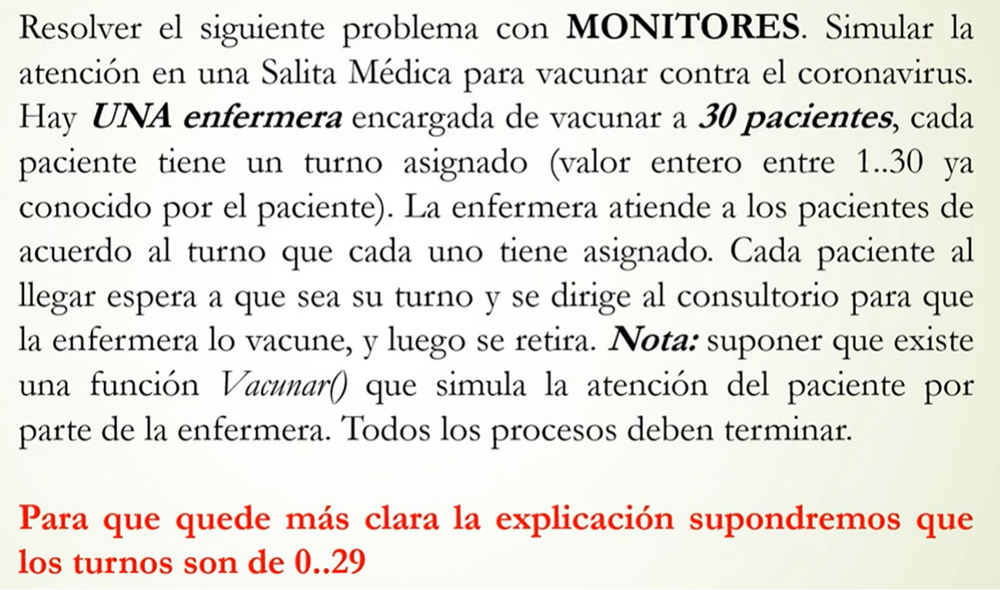

# [M] Parque

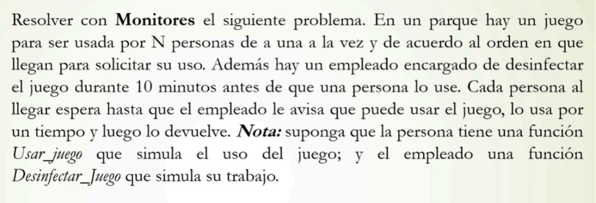

```pseudocode
Monitor AdminJuegos {
    cond espera_juegos, limpieza;
    cond emp;
    int cantEsperando = 0;
    boolean libre = true;
    boolean pideLimpieza = false;
    boolean juegoLimpio = false;

    Procedure esperarPersona() {
        if (not pideLimpieza) {
            wait(emp);
        }
        pideLimpieza = false;
    }

    Procedure habilitarJuego() {
        juegoLimpio = true;
        signal(limpieza);
    }

    Procedure esperarJuego() {
        if (libre) {
            libre = false;
        } else {
            cantEsperando++;
            wait(espera_juegos);
        }
        pideLimpieza = true;
        signal(emp);
        if (!juegoLimpio) {
            wait(limpieza);
        }
        juegoLimpio = false;
    }

    Procedure liberarJuego() {
        if (cantEsperando == 0) {
            libre = true;
        } else {
            cantEsperando--;
            signal(espera_juegos);
        }
    }
}

Process Persona[id: 0..N-1] {
    AdminJuegos.esperarJuego();
    Usar_juego();
    AdminJuegos.liberarJuego();
}

Process Empleado {
    int i;
    for i = 1..N {
        AdminJuegos.esperarPersona();
        Desinfectar_Juego();
        AdminJuegos.habilitarJuego();
    }
}
```

# Consumidores

Existen *M* productores y *C* consumidores que se comunican mediante un buffer circular de tamaño *n*. Los productores depositan mensajes en el buffer y los consumidores los retiran para procesarlos. Se debe maximizar la concurrencia.

```pseudocode
int buffer[N];
int libre = 0;
int ocupado = 0;
sem vacio = N;
sem lleno = 0;
sem mutexP = 1;
sem mutexC = 1;

Process Productor[id: 1..M] {
    int dato;
    while (true) {
        dato = ...;
        P(vacio);
        P(mutexP);
        buffer[libre] = dato;
        libre = (libre + 1) MOD N;
        V(mutexP);
        V(lleno);
    }
}

Process Consumidor[id: 1..C] {
    int dato;
    while (true) {
        P(lleno);
        P(mutexC);
        dato = buffer[ocupado];
        ocupado = (ocupado + 1) MOD N;
        V(mutexC);
        P(vacio);
    }
}
```

# PARCIAL 6/5/2026

1.

```pseudocode
sem ubicado = 0;
sem barrera = 0;
sem mutex = 1;
Cola c;
sem termine = 0;
sem espera_puesto = ([22] 0);
int puestos[22];

Process Auto[id: 0..21] {
    int i;
    int miPuesto;

    UBICARSE();
    V(ubicado);
    P(barrera);

    for i = 1..50 {
        DAR_VUELTA();
    }

    P(mutex);
    push(c, id);
    V(mutex);
    V(termine);
    P(espera_puesto[id]);
    miPuesto = puestos[id];
}

Process Comisario {
    int i;
    int idAuto;
    int puestoAct = 1;
    boolean correcto;

    for i = 1..22 {
        P(ubicado);
    }

    for i = 1..22 {
        V(barrera);
    }

    for i = 1..22 {
        P(termine);
        P(mutex);
        pop(c, idAuto);
        V(mutex);
        correcto = REVISAR(idAuto);
        if (correcto) {
            puestos[idAuto] = puestoAct;
            puestoAct++;
        } else {
            puestos[idAuto] = -1;
        }
        V(espera_puesto[idAuto]);
    }
}
```

2.

```pseudocode
Monitor AdminCircuito[id: 0..2] {
    boolean libre = true;
    cond espera_F1, espera_F2;
    ColaOrdenada fila;

    Procedure entrar(esF1: in boolean; idAct: in int) {
        if (libre) {
            libre = false;
        } else {
            push(fila, esF1, idAct);
            if (esF1) {
                wait(espera_F1);
            } else {
                wait(espera_F2);
            }
        }
    }

    Procedure salir() {
        int idAct;
        boolean esF1;
        if (empty fila) {
            libre = true;
        } else {
            pop(fila, esF1, idAct);
            if (esF1) {
                signal(espera_F1);
            } else {
                signal(espera_F2);
            }
        }
    }
}

Process AutoF1[id: 0..21] {
    int miCircuito = ...;

    AdminCircuito[miCircuito].entrar(true, id);
    USAR(); // corre durante 3hs
    AdminCircuito[miCircuito].salir();
}

Proces AutoF2[id: 0..27] {
    int miCircuito = ...;

    AdminCircuito[miCircuito].entrar(false, id);
    USAR(); // corre durante 3hs
    AdminCircuito[miCircuito].salir();
}
```
