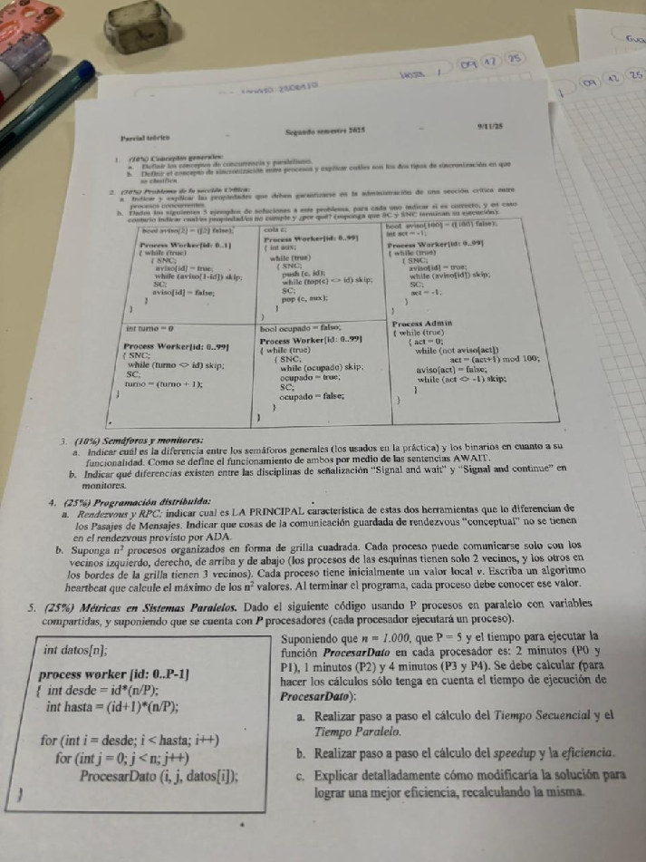

# 9/11/2025



1.
   1. concurrencia: concurrencia es la especificación de procesos que se comunican y sincronizan entre sí, sin importar si son ejecutados en uno o en varios procesadores.

      paralelismo: capacidad concurrente de varios procesadores de ejecutar actividades en el mismo instante de tiempo, pensada para reducir el tiempo de ejecución.
   2. la sincronización es la posesión de información acerca de otro proceso para coordinar actividades.
      1. sincronización por exclusión mutua: se garantiza que, en un mismo instante de tiempo, solo haya un proceso operando sobre un recurso compartido.
      2. sincronización por condición: se demora en un punto del programa la ejecución de un proceso hasta que se cumpla una cierta condición.
2.
   1.
      1. exclusión mutua: propiedad de seguridad que asegura que, en un mismo instante de tiempo, solo haya un proceso operando sobre un recurso compartido.
      2. ausencia de deadlock: propiedad de vida que asegura que si 2 o más procesos tratan de entrar a sus SC, al menos uno tendrá éxito.
      3. ausencia de demora innecesaria: propiedad de vida que asegura que si un proceso trata de entrar a su SC y los demás están en su SNC o terminaron, el primero no puede quedar impedido de entrar.
      4. eventual entrada: propiedad de vida que asegura que un proceso que intenta entrar a su SC tiene posibilidades de lograrlo eventualmente.
   2.
      1. ```pseudocode
         bool aviso[2] = ([2] false);

         Process Worker[id: 0..1]
         { while (true)
           { SNC;
             aviso[id] = true;
             while (aviso[1-id]) skip;
             SC;
             aviso[id] = false;
           }
         }
         ```

         hay riesgo de deadlock ya que, entre la asignación en true de aviso[i] y el while, puede pasar que los dos procesos queden con su aviso en true y se queden iterando eternamente en el while.
      2. ```pseudocode
         cola c;

         Process Worker[id: 0..99]
         { int aux;
           while (true)
           { SNC;
             push (c, id);
             while (top(c) <> id) skip;
             SC;
             pop (c, aux);
           }
         }
         ```

         el código es correcto.
      3. ```pseudocode
         bool aviso[100] = ([100] false);
         int act = -1;

         Process Worker[id: 0..99]
         { while (true)
           { SNC;
             aviso[id] = true;
             while (aviso[id]) skip;
             SC;
             act = -1;
           }
         }

         Process Admin
         { while (true)
           { act = 0;
             while (not aviso[act])
               act = (act+1) mod 100;
             aviso[act] = false;
             while (act <> -1) skip;
           }
         }
         ```

         cumple exclusión mutua (el admin solo libera un aviso a la vez y espera act=-1 antes de seguir) y ausencia de deadlock (el scan siempre encuentra a alguien si hay algún aviso en true), pero no cumple eventual entrada. al resetear siempre a 0, el algoritmo le da prioridad estructural permanente a los índices bajos por sobre los altos, y esa asimetría es la que abre la puerta a la inanición (starvation) de índices altos si los de índice bajo no dejan nunca de competir.
      4. ```pseudocode
         int turno = 0

         Process Worker[id: 0..99]
         { SNC;
           while (turno <> id) skip;
           SC;
           turno = (turno + 1);
         }
         ```

         el código funciona y cumple con las propiedades.
      5. ```pseudocode
         bool ocupado = false;

         Process Worker[id: 0..99]
         { while (true)
           { SNC;
             while (ocupado) skip;
             ocupado = true;
             SC;
             ocupado = false;
           }
         }
         ```

         el código no cumple con la propiedad de exclusión mutua. al while(ocupado) podrían llegar dos procesos al mismo tiempo que leerían false simultáneamente, accediendo a la SC de forma conjunta (el chequeo y la asignación son dos pasos separados, no una sola acción atómica).
3.
   1. los semáforos generales están diseñados para soportar un valor entero mayor a 1 permitiendo, en un caso práctico, que más de un proceso atraviese la operación P(semaforo) hasta que el valor llegue a 0.

      funcionamiento:
      ```pseudocode
      P(sG) { < await(sG > 0) sG = sG - 1 > }
      V(sG) { < sG = sG + 1 > }
      ```

      los semáforos binarios, en cambio, solo soportan hasta el 1 como valor entero.

      funcionamiento:
      ```pseudocode
      P(sB) { < await (sB > 0) sB = sB - 1 > }
      V(sB) { < await (sB < 1) sB = sB + 1 > }
      ```
   2. signal and continue (S&C): el que señaliza sigue teniendo el monitor; el despertado tiene que volver a competir por entrar.

      signal and wait (S&W): el que señaliza cede el monitor de inmediato; el despertado entra directo, sin competir con nadie más.
4.
   1. RPC y Rendezvous combinan una interfaz 'tipo monitor' con operaciones exportadas a través de llamadas externas (CALL) con mensajes sincrónicos (demoran al llamador hasta que la operación llamada se termine de ejecutar y se devuelvan los resultados)

      ADA no tiene las expresiones de scheduling opcionales que el modelo conceptual de comunicación guardada sí tiene. ADA implementa el select ... when B_i => accept E_i ... — es decir, sí tiene las guardas booleanas B_i. pero no tiene el by e_i: cuando dos o más alternativas están simultáneamente habilitadas (guarda verdadera y hay un llamado pendiente), ADA no permite indicar con qué criterio elegir entre ellas.
   2. ```pseudocode
      chan valores[1:n,1:n](int);

      process P[i: 1..n, j: 1..n] {
          int max = v;
          int maxAux;
          int vecinos = 0;

          for (int di = -1 to 1) {
              for (int dj = -1 to 1 st (di != dj) and (di + dj != 0)) {
                  if (i + di >= 1) and (j + dj >= 1) and (i + di <= n) and (j + dj <= n) {
                      vecinos++;
                  }
              }
          }

          for (int r = 1 to 2*(n-1)) {
              for (int di = -1 to 1) {
                  for (int dj = -1 to 1 st (di != dj) and (di + dj != 0)) {
                      if (i + di >= 1) and (j + dj >= 1) and (i + di <= n) and (j + dj <= n) {
                          send valores[i + di, j + dj](max);
                      }
                  }
              }

              for (int v = 1 to vecinos) {
                  receive valores[i,j](maxAux);
                  if (maxAux > max) max = maxAux;
              }
          }
      }
      ```

# 16/12/2024

**Parcial teórico — Segundo semestre 2024 — 16/12/24**

**1. (30%) Problema de la sección Crítica:**

**a. Indicar cuáles son las 4 propiedades necesarias que deben cumplir las soluciones para este problema. Definir cada una de ellas, y explicar qué problema puede generar que no se cumpla dicha propiedad.**

1. exclusión mutua: propiedad de seguridad que enuncia que no hay más de un proceso ejecutando una misma sección crítica en el mismo instante de tiempo.
   1. la ausencia de corchetes angulares en una sentencia en la que se actualiza una variable compartida a partir de ella misma (por ej.: variableCompartida = variableCompartida + i) produce que dos procesos puedan ejecutar esa sentencia 'al mismo tiempo'; como internamente son varios pasos (Load, Add, Store), sus pasos se entrelazan y se pierden actualizaciones — el valor final queda por debajo del esperado.
2. ausencia de deadlock: propiedad de vida que garantiza que, si hay 2 o más procesos preparados para entrar a una sección crítica, al menos uno debe poder entrar.
   1. por ejemplo, si cada proceso avisa su intención de entrar *antes* de fijarse si el otro también avisó, ambos pueden verse mutuamente interesados y quedar esperando el uno al otro sin que ninguno ceda.
3. ausencia de demora innecesaria: propiedad de vida que asegura que si un proceso trata de entrar a su SC y los demás están en su SNC o terminaron, el primero no puede quedar impedido de entrar.
   1. por ejemplo, un coordinador que asigna los turnos a los procesos para entrar a sus SC de forma consecutiva, se queda esperando la solicitud de un proceso que no está pidiendo entrar, mientras que otro que sí quiere entrar no puede hacerlo.
4. eventual entrada: propiedad de vida que garantiza que un proceso que intenta entrar a su SC tiene posibilidades de lograrlo eventualmente.
   1. por ejemplo, un coordinador que siempre revisa a los candidatos empezando desde el mismo punto de partida termina favoreciendo sistemáticamente a los primeros de la lista, dejando esperando para siempre a los últimos si los primeros siguen re-compitiendo.

**b. Dados los siguientes 3 ejemplos de soluciones a este problema, para cada uno indicar si es correcto, y en caso contrario indicar cuál/es propiedad/es no cumple/n y por qué (suponga que SC y SNC terminan su ejecución).**

**Código 1:**

```pseudocode
bool aviso[100] = ([100] false);
bool libre = true;

Process Worker[id: 0..99]
{ while (true)
  { SNC;
    aviso[id] = true;
    while (aviso[id]) skip;
    SC;
    libre = true;
  }
}

Process Admin
{ int i = 0;
  while (true)
  { while (not aviso[i])
      i = (i+1) mod 100;
    aviso[i] = false;
    libre = false;
  }
}
```

viola exclusión mutua. cuando dos procesos X e Y (X < Y) ponen su aviso en true, el admin le da permiso a X y, si X sigue en su SC hasta que el admin le da permiso también a Y, entonces Y también entraría a su SC. la variable libre no sirve de nada.

**Código 2:**

```pseudocode
bool aviso[100] = ([100] false);
bool libre = true;

Process Worker[id: 0..99]
{ while (true)
  { SNC;
    aviso[id] = true;
    while (aviso[id]) skip;
    SC;
    libre = true;
  }
}

Process Admin
{ int i = 0;
  while (true)
  { while (not aviso[i])
      i = (i+1) mod 100;
    aviso[i] = false;
    libre = false;
    while (not libre) skip;
  }
}
```

es correcto.

**Código 3:**

```pseudocode
bool aviso[100] = ([100] false);
bool libre = true;

Process Worker[id: 0..99]
{ while (true)
  { SNC;
    aviso[id] = true;
    while (aviso[id]) skip;
    SC;
    libre = true;
  }
}

Process Admin
{ int i = 0;
  while (true)
  { while (not aviso[i]) skip;
    aviso[i] = false;
    libre = false;
    while (not libre) skip;
    i = (i+1) mod 100;
  }
}
```

viola la propiedad de ausencia de demora innecesaria. el admin, recorriendo consecutivamente cada worker i, esperando que le avisen que quiere entrar a su SC de forma ascendente, puede hacer esperar innecesariamente otros workers. por ejemplo, si llega el worker 50, este debe esperar que 50 workers (0..49) pidan entrar a la SC.

**2. (20%) Memoria Compartida:**

**a. Explicar las 3 formas diferentes en que se pueden usar las sentencias AWAIT. Ejemplifique.**

1. acción atómica incondicional (< S; >): indica que la sentencia S se ejecuta con exclusión mutua sin esperar ninguna condición para poder ejecutarla.
   1. ejemplo:
      ```pseudocode
      int variableCompartida = 0;

      process worker[id: 1..5] {
          int i;
          for (i = 0 to 50) do < variableCompartida = variableCompartida + i; >
      }
      ```
2. sincronización por condición (await(B)): el proceso se demora hasta que la condición B sea verdadera, y sigue si ejecución normalmente.
   1. ejemplo:
      ```pseudocode
      int act = 1;

      process worker[id: 1..5] {
          await(act == id);
          write(“Hola”);
          act = id + 1;
      }
      ```
3. sincronización por condición + exclusión mutua (< await(B) S; >): el proceso se demora hasta que la condición B sea verdadera, y entonces ejecuta la sentencia S con exclusión mutua.
   1. ejemplo:
      ```pseudocode
      bool libre = true;

      process worker[id: 1..5] {
          < await(libre) libre = false >
          write(“Hola”);
          libre = true;
      }
      ```

**b. Cuál es la diferencia entre los semáforos generales (los usados en la práctica) y los binarios en cuanto a su funcionalidad. Cómo se define el funcionamiento de ambos por medio de las sentencias AWAIT.**

- los semáforos generales admiten valores enteros mayores a 1 permitiendo, en la práctica, que más de 1 proceso se quede demorado en una sentencia P(semaforo).

  funcionamiento:
  - P(g) { < await(g > 0) g = g - 1; > }
  - V(g) { < g = g + 1; > }
- los semáforos binarios solo admiten hasta el valor entero 1, restringiendo que

**c. Explicar la diferencia entre los protocolos de señalización para monitores: *signal and wait* y *signal and continue*.**

- signal and wait: enuncia que el proceso que hace signal sobre una variable condición, vuelve a competir para poder entrar al monitor, mientras que el proceso despertado sigue su ejecución desde donde se despertó.
- signal and continue: esta política indica que el proceso que hace signal sobre una variable condición, continúa su ejecución sin problemas y el proceso despertado vuelve a competir para entrar al monitor.

**3. (20%) Programación distribuida: indicar al menos 2 diferencias entre ambos PMA y PMS (relacionado con su funcionalidad, no con su sintaxis). Indicar la principal ventaja de PMS sobre PMA. Indicar cuál es LA PRINCIPAL característica común de RPC y Rendezvous que lo diferencian de los Pasajes de Mensajes.**

- la primera diferencia es que el envío de mensajes en PMA es asincrónico, es decir, que una vez enviado el mensaje al canal, el proceso emisor sigue su ejecución. PMS, en cambio, exige que el emisor se demore hasta que el receptor llegue a la sentencia de recepción y reciba el mensaje enviado.
- la segunda diferencia es que en PMA, como el send no bloquea al emisor, este puede seguir enviando mensajes sin esperar a que los anteriores sean recibidos, por lo que la cola de un canal puede acumular más de un mensaje. en PMS, el emisor no puede continuar hasta que el mensaje actual sea recibido, así que cada link tiene como máximo 1 mensaje pendiente.
- la principal ventaja de PMS sobre PMA es que PMS suele usar muchísima menos memoria que PMA ya que el primero solo puede alojar como máximo un mensaje, y el segundo ilimitados.
- la principal característica de RPC y Rendezvous es que el emisor se queda demorado no solo hasta que el receptor recibe el mensaje, sino hasta que el receptor otorga una respuesta, modelando así un tipo de “cita” o handshake completo entre el emisor y receptor en forma de canal bidireccional.

**4. (30%) Métricas en Sistemas Paralelos. Sea la siguiente solución a un problema de matrices de n×n con P procesos en paralelo con variables compartidas. Suponga n = 1000 y cada procesador capaz de ejecutar un proceso. *Nota: para hacer los cálculos sólo tenga en cuenta las operaciones realizadas en la instrucción dentro del for Y.***

```pseudocode
int a[n,n], b[n,n]; --Datos cargados
int d[n,n], e[n,n];

process worker [w: 0..P-1] {
    int x, y;
    int primera = w*(n/P);
    int ultima = primera + (n/P) -1;

    for (x = primera; x <= ultima; x++)
        for (y = 0; y < n; y++)
        { d[x,y] = a[x,y] + b[x,y];
          e[x,y] = a[x,y] * b[x,y];
        };
}
```

**a. Calcular cuántas asignaciones, sumas y productos se hacen secuencialmente (caso en que P=1); y cuántas se realizan en cada procesador en la solución paralela con P=10.**

- con P=1 se hacen 2000000 asignaciones, 1000000 sumas y 1000000 productos
- con P=10 se hacen, por cada procesador, 200000 asignaciones, 100000 sumas y 100000 productos

**b. Dados que los procesadores de P1 a P4 son idénticos, con tiempos de asignación 2, de suma 4 y de producto 8; los procesadores de P5 a P8 son la mitad de potentes que los anteriores (tiempos 4, 8 y 16 para asignaciones, sumas y productos respectivamente); y los procesadores P9 y P10 son el doble de potentes que los primeros (tiempos 1, 2 y 4 para asignaciones, sumas y productos respectivamente). Calcular cuánto tarda el programa paralelo y el secuencial.**

- programa paralelo:
  - max((2*200000 + 4*100000 + 8*100000), (4*200000 + 8*100000 + 16*100000), (1*200000 + 2*100000 + 4*100000)) = max(1600000, 3200000, 800000) = 3200000
- programa secuencial:
  - usando el mejor procesador (P9)
  - (1*2000000 + 2*1000000 + 4*1000000) = 8000000

**c. Realizar paso a paso el cálculo del valor del speedup y la eficiencia.**

- speedup = 8000000 / 3200000 = 2.5

  speedup óptimo = (4*1 + 4*0.5 + 2*2) / max(1, 0.5, 2) = 10 / 2 = 5
- eficiencia = 2.5 / 5 = 0.5 → 50%

**d. Explicar detalladamente cómo modificaría la solución para lograr una mejor eficiencia. Recalculando la misma.**

repartiría el problema proporcionalmente a la potencia de cálculo de cada procesador. teniendo 1000 filas y potencia total = 10, repartiría 1000 / 10 = 100 filas por unidad de potencia.

- P1 - P4: cada uno tiene potencia 1, entonces le iría 100 filas a c/u.
- P5 - P8: cada uno tiene potencia 0.5, entonces le iría 50 filas a c/u.
- P9 - P10: cada uno tiene potencia 2, entonces le iría 200 filas a c/u.

4 * 100 + 4 * 50 + 2 * 200 = 400 + 200 + 400 = 1000.

recálculo de la eficiencia:

- programa paralelo:
  - max((2*200000 + 4*100000 + 8*100000), (4*100000 + 8*50000 + 16*50000), (1*400000 + 2*200000 + 4*200000)) = max(1600000, 1600000, 1600000) = 1600000
- programa secuencial:
  - (1*2000000 + 2*1000000 + 4*1000000) = 8000000
- speedup = 8000000 / 1600000 = 5

  speedup óptimo = (4*1 + 4*0.5 + 2*2) / max(1, 0.5, 2) = 10 / 2 = 5
- eficiencia = 5 / 5 = 1 → 100%

# 3/8/2022

**Examen teórico de promoción — 03/08/2022**

---

**1) (0.5 puntos) Conceptos generales:**

**a. Escribir una definición de *programación concurrente* y *programación paralela*, diferenciando ambos conceptos.**

la programación concurrente es un concepto de software, no restringido a una arquitectura particular de hardware ni a una cantidad de procesadores, que describe la ejecución “simultánea” de actividades para resolver un problema.

la programación paralela, en cambio, sí se enfoca en el uso de más de un procesador para resolver tareas concurrentes, con el fin de acortar el tiempo de ejecución que requeriría un solo procesador.

la simultaneidad es diferente entre la concurrencia con un solo procesador y el paralelismo. con un solo procesador, el tiempo de CPU se comparte entre los procesos (por ejemplo por *time slicing*) y hay *context switch*, o sea que la ejecución está entrelazada. en el procesamiento paralelo, en cambio, sí es posible ejecutar varias partes de procesos en el mismo instante de tiempo ya que hay más de una unidad de procesamiento.

**b. Definir lo que es la sincronización entre procesos y explicar cuáles son los dos tipos de sincronización en que se clasifica. Dar un ejemplo (explicarlo con palabras, no con código) de un problema donde se usen ambos tipos de sincronización.**

la sincronización es la posesión de información sobre otro proceso para poder llegar a coordinar actividades.

- sincronización por exclusión mutua: determina que debe haber un solo proceso en el mismo instante de tiempo operando sobre un recurso compartido por más de un proceso.
- sincronización por condición: se utiliza para que un proceso demore su ejecución hasta que una condición se determina verdadera.
- ejemplo donde se usan las dos: N alumnos deben rendir un examen. para ello, una vez que se presentan todos en el aula y se sientan (sincronización por condición para una barrera), hacen su examen y se dirigen al escritorio del profesor para que uno por uno (exclusión mutua) le entregue su examen en mano.

**c. Definir comunicación entre procesos. Explicar cuáles son los dos tipos de comunicación que existen.**

la comunicación entre procesos concurrentes indica el modo en que se organizan y transmiten datos entre tareas concurrentes. esta organización requiere especificar protocolos para controlar el progreso y la corrección.

- comunicación por memoria compartida: los procesos intercambian información a través de datos ubicados en la sección de la memoria compartida. uno escribe en una variable compartida y otro la lee, de modo que la comunicación es indirecta. estas operaciones requieren de estrategias explícitas de sincronización, como los semáforos, ya que sino se puede generar interferencia.
- comunicación por pasaje de mensajes: los procesos intercambian información a través de canales de mensajes lógicos o físicos. acá la comunicación es explícita y directa. no existen variables ni recursos compartidos, solo los canales de mensajes que pueden utilizar los procesos, los cuales no se encuentran en memoria compartida, así que no hay que aplicar exclusión mutua.

**d. Indicar qué es la programación distribuida y cuáles son las características que lo diferencian de la programación con memoria compartida.**

la programación distribuida es un tipo de programación concurrente que no requiere el uso de variables compartidas para que los procesos se comuniquen entre sí, sino canales lógicos o físicos para el pasaje de mensajes y un protocolo que los interprete.

características que la diferencian de la programación con memoria compartida:

- utiliza pasaje de mensajes como método de comunicación en vez de variables compartidas
- la comunicación es directa entre emisor y receptor, a diferencia de la comunicación indirecta en memoria compartida
- supone ejecución sobre una arquitectura de memoria distribuida: cada procesador tiene su memoria local, conectados por red, y el intercambio se hace por mensajes.
- los procesos sólo comparten canales (lógicos o físicos), no variables.
- la exclusión mutua no requiere un mecanismo especial, a diferencia de memoria compartida donde es explícita y a cargo del programador.

---

**2) (1.5 puntos) Problema de la sección Crítica:**

**a. Nombrar y explicar 4 propiedades que debe cumplir una solución a este problema. Para cada una de estas 4 propiedades explicar la idea de una solución que no cumpla dicha propiedad (con palabras, no con código).**

1. exclusión mutua: enuncia que solo un proceso se puede encontrar en una SC en el mismo instante de tiempo.
   1. ejemplo: un proceso pregunta si el booleano llamado “libre” que “protege” a la SC está en true. si lo está, entonces ingresa y luego lo pone en false. esto puede hacer que entre más de un proceso a la SC ya que las operaciones de lectura y asignación en false del booleano tiene varios pasos internos (Load, Store, etc.). mientras el proceso entraba a la SC, otro proceso podría haber visto el instante justo en el que el booleano seguía en true y también entrar.
2. ausencia de deadlock: garantiza que si hay 2 o más procesos preparados para entrar a su SC, al menos uno tendrá éxito.
   1. ejemplo: si dos procesos avisan que van a entrar a la SC al mismo tiempo, y luego de hacerlo evalúan que otro proceso no haya avisado que va a entrar, se van a quedar demorados para siempre ya que las dos flags van a estar levantadas.
3. ausencia de demora innecesaria: asegura que si hay un proceso preparado para entrar a su SC, y todos los demás están en su SNC o terminaron, ese proceso debe poder entrar inmediatamente.
   1. ejemplo: supóngase que 100 procesos workers deben esperar a que un coordinador les habilite pasar a la SC, y el coordinador siempre arranca a autorizar workers desde la id=0. entonces, si llegara primero el worker 50, el mismo debería esperar innecesariamente que lleguen 49 workers de forma ordenada ascendentemente para poder acceder, porque el coordinador se queda bloqueado esperando a cada worker en orden.
4. eventual entrada: indica que un proceso que intenta entrar a su SC, eventualmente lo logra.
   1. ejemplo: un coordinador que, cuando hay varios pedidos pendientes, atiende siempre el de menor id entre todas las id. si los procesos 1 y 2 piden entrar continuamente, el coordinador alterna entre ellos para siempre y el proceso 100 nunca es elegido, aunque haya pedido primero. otra vez: el sistema funciona, la exclusión mutua se cumple, no hay deadlock, pero un proceso concreto se muere de hambre.

**b. Desarrollar una solución de GRANO FINO usando sólo variables compartidas (no usar `await`, sentencias especiales como TS, semáforos o monitores) usando un coordinador. En este caso, cuando un proceso SC[i] quiere entrar a su sección crítica le avisa al coordinador, y espera a que éste le dé permiso. Al terminar de ejecutar su sección crítica, el proceso SC[i] le avisa al coordinador.**

```pseudocode
boolean permiso[1:N] = ([N] false);
boolean aviso[1:N] = ([N] false);
boolean libre[1:N] = ([N] false);

process SC[id: 1..N] {
    while (true) {
        aviso[id] = true;
        while (not permiso[id]) skip;
        SC;
        permiso[id] = false;
        libre[id] = true;
        SNC;
    }
}

process coordinador {
    while (true) {
        for (i = 1 to N) {
            if (aviso[i]) {
                aviso[i] = false;
                permiso[i] = true;
                while (not libre[i]) skip;
                libre[i] = false;
            }
        }
    }
}
```

---

**3) (1 punto) Monitores: indicar cómo se realiza en monitores la comunicación y la sincronización (ambos tipos de sincronización) entre procesos. Explicar la diferencia entre los protocolos de sincronización en monitores: *signal and wait* (S&W) y *signal and continue* (S&C).**

- la comunicación se realiza invocando los procedures del monitor. es decir, la comunicación es indirecta: un proceso llama a un procedimiento depositando su información, el procedimiento la procesa y almacena de cierta manera, y otro proceso obtiene esa información llamando también al procedimiento.
- sincronización:
  - la exclusión mutua se da de manera implícita, garantizando que solo un proceso se encuentre en todo el monitor ejecutando un procedimiento del mismo en un mismo instante de tiempo.
  - la sincronización por condición se realiza mediante variables condición que funcionan como colas de espera ordenadas por llegada y sus operaciones:
    - signal(cv): despierta al proceso que se encuentra demorado en la cabeza de la cola de cv
    - signal_all(cv): despierta a todos los procesos demorados en la cola de cv
    - wait(cv): el proceso se demora al final de la cola de cv y libera el acceso exclusivo al monitor.
  - signal and wait: el proceso que hace signal sobre una variable condición pasa a competir nuevamente por acceder al monitor, mientras que el proceso despertado continúa su ejecución a partir de la instrucción que le sigue al wait donde estaba dormido.
  - signal and continue: el proceso que hace signal sobre una variable condición continúa su ejecución normalmente, mientras que el proceso despertado vuelve a competir por acceder al monitor.

---

**4) (0.5 puntos) PMA y PMS: Explicar el funcionamiento general de PMA y PMS. Indicar y explicar las sentencias que posee para realizar las comunicaciones básicas.**

- PMA: el pasaje de mensajes se hace sobre canales compartidos. esos canales poseen operaciones con exclusión mutua implícita:
  - send canal(mensaje): operación para encolar un mensaje en el canal. el emisor deposita su mensaje y sigue su ejecución normalmente.
  - receive canal(mensaje): operación para desencolar el mensaje menos reciente enviado al canal.
  - además, se pueden declarar vectores de canales y operar sobre ellos (send canal[i](mensaje_i), receive canal[i](mensaje_i));
- PMS: el pasaje de mensajes se hace sobre links o canales punto a punto donde, como máximo, habrá un mensaje encolado ya que el envío de mensajes es sincrónico:
  - Medico!mostrador(receta): el emisor envía un mensaje “receta” a un proceso “Medico” por el canal “mostrador”. el emisor se queda demorado hasta que Medico reciba el mensaje.
  - Paciente?mostrador(receta): el receptor recibe el mensaje. recién ahí, el emisor puede continuar con su ejecución.
  - Paciente[*]?turnos(pedido): el receptor espera mensajes de cualquier emisor.
- conclusión: en PMA, la emisión no es bloqueante y la recepción sí, mientras que en PMS los dos son bloqueantes.

---

**5) (0.5 puntos) RPC y Rendezvous: Explicar las características comunes y las diferencias entre Rendezvous y RPC. Indicar qué cosas de la comunicación guardada de rendezvous "conceptual" no se tienen en el rendezvous provisto por ADA.**

- similitudes: son mecanismos de comunicación y sincronización entre procesos en sistemas distribuidos, especiales para protocolos cliente/servidor. la principal característica es que, durante el pasaje de mensajes, el emisor se queda demorado no solo hasta que el receptor recibe el mensaje, sino también hasta que se devuelve una respuesta. esto se asemeja a un modelo de tipo “cita” o handshake en forma de canales bidireccionales.
- diferencias: cuando se envía un mensaje, RPC crea un nuevo proceso para manejar la llamada. el mensaje es enviado a ese nuevo proceso, se trata dentro, y por último se devuelve un resultado. por lo contrario, Rendezvous no crea ningún nuevo proceso, sino que realiza ese encuentro con uno ya existente.

  además, en RPC no existen herramientas de sincronización, las mismas deben implementarse mediante semáforos, monitores, u otros mecanismos. en Rendezvous, la sentencia de entrada IN en el proceso servidor se encarga de la sincronización, bloqueando al servidor hasta que llegue una invocación y al cliente hasta que se complete la operación.
- comunicación guardada: al Rendezvous de ADA le falta lo siguiente:
  - no tiene expresión de scheduling “by e →”. no se puede indicar con qué criterio elegir entre varias invocaciones pendientes cuando más de una guarda está habilitada.
  - la guarda when B no puede referenciar los parámetros formales del entry, porque se evalúa antes de ejecutar el accept, o sea antes de que lleguen los argumentos. en el rendezvous conceptual, los Bi y los ei sí pueden referenciar los parámetros formales.

---

**6) (1 punto) Librería Pthreads: explicar cómo se maneja la sincronización (ambos tipos de sincronización) en la librería Pthreads, y cómo se relacionan entre ellas (¿por qué para realizar una de las sincronizaciones necesita de la otra?).**

- exclusión mutua:
  - existen las variables mutex que pueden tener dos estados: locked y unlocked.
  - en cualquier instante, solo un thread puede bloquear un mutex.
  - para entrar a la SC el thread debe lograr el control del mutex (bloquearlo), y al salir debe desbloquearlo. todos los mutex deben inicializarse como desbloqueados.
    ```pseudocode
    pthread_mutex_lock(&mutex);
        // Sección Crítica
    pthread_mutex_unlock(&mutex);
    ```
- sincronización por condición: se permite que un thread se autobloquee hasta que se alcance un estado determinado del programa. cada variable condición está asociada con un predicado: cuando el predicado se vuelve verdadero, la variable condición da una señal a los threads que esperan por ese cambio de estado. si el predicado es falso, el thread espera con pthread_cond_wait, que NO usa CPU (no es busy waiting).
  - una variable de condición siempre tiene un mutex asociado a ella. cada thread bloquea ese mutex y testea el predicado definido sobre la variable compartida.

    el predicado de la variable condición se evalúa sobre variables compartidas. testear ese predicado y decidir si dormirse debe ser una acción atómica; si no lo fuera, entre el test y el wait otro thread podría cambiar el estado y hacer el signal, y ese signal se perdería (no tiene efecto si nadie está esperando) → el thread quedaría dormido para siempre (deadlock por señal perdida). por eso pthread_cond_wait recibe el mutex como parámetro: libera el mutex atómicamente al dormirse (si no lo liberara, nadie podría entrar a modificar la condición) y lo readquiere automáticamente al despertar.

---

**7) (1 punto) Librerías para Pasaje de Mensajes: Explicar los 4 diferentes tipos de SEND en que se clasifican las comunicaciones punto a punto en las librerías de Pasaje de Mensajes en general (no se refiere particularmente a MPI). Indicar cuáles se corresponden con las herramientas PMA y PMS de la pregunta 4.**

las comunicaciones punto a punto se clasifican primero en bloqueantes (el Send no retorna hasta asegurar que el dato está seguro) y no bloqueantes (retornan el control inmediatamente, dejando en el programador el chequeo posterior de finalización con Test/Wait). dentro de cada una hay una sub-clasificación con/sin buffering, según si el dato se copia a un buffer intermedio o no, dando 4 tipos: Ssend (bloqueante sin buffer), Bsend (bloqueante con buffer), y sus versiones no bloqueantes, siendo Isend (no bloqueante con buffer) la más usada en la práctica. PMS corresponde a Ssend, y PMA corresponde al esquema con buffering (su canal actúa como cola).

---

**8) (2 puntos) Paradigmas de interacción: Suponga que una imagen se encuentra representada por una matriz A(nxn), y que el valor de cada pixel es un número entero que es mantenido por un proceso distinto (es decir, el valor del pixel i,j está en el proceso P(i,j)). Cada proceso puede comunicarse a lo sumo con sus 8 vecinos que lo rodean (o la cantidad que tenga si está en los bordes). Escriba un algoritmo *heartbeat* que calcule el máximo y el mínimo valor de los pixels de la imagen. Al terminar el programa, cada proceso debe conocer ambos valores.**

```pseudocode
chan valores[1:n,1:n](int,int);

process P[i: 1..n; j: 1..n] {
    int max = A[i,j];
    int min = A[i,j];
    int maxAux, minAux;
    int cantVecinos = 0;

    for (int di = -1 to 1) {
        for (int dj = -1 to 1 st (di != 0 or dj != 0)) {
            if ((i+di >= 1) and (i+di <= n) and (j+dj >= 1) and (j+dj <= n)) {
                cantVecinos++;
            }
        }
    }

    for (int r = 1 to n-1) {
        for (int di = -1 to 1) {
            for (int dj = -1 to 1 st (di != 0 or dj != 0)) {
                if ((i+di >= 1) and (i+di <= n) and (j+dj >= 1) and (j+dj <= n)) {
                    send valores[i+di, j+dj](max,min);
                }
            }
        }

        for (int v = 1 to cantVecinos) {
            receive valores[i, j](maxAux,minAux);
            if (maxAux > max) max = maxAux;
            if (minAux < min) min = minAux;
        }
    }
}
```

---

**9) (2 puntos) Métricas en Sistemas Paralelos: Sea la siguiente solución al problema del producto de matrices de nxn con P procesos en paralelo con variables compartidas. Suponga n = 640 y que cada procesador es capaz de ejecutar un proceso.**

```pseudocode
process worker [w = 1 to P] {
    int primera = (w-1)*(n/P) + 1;
    int ultima = primera + (n/P) - 1;

    for [i = primera to ultima]
    {  for [j = 1 to n]
       {  c[i,j] = 0;
          for [Z = 1 to n]
             c[i,j] = c[i,j] + (a[i,Z] * b[Z,j]);
       }
    }
}
```

**a. Calcular cuántas asignaciones, sumas y productos se hacen secuencialmente (caso en que P=1), y cuántas se realizan en cada procesador en la solución paralela con P=8.**

- P=1:
  - primera = (1-1)*(640/1)+1 = 1
  - ultima = 1 + (640/1)-1 = 640
  - for i = 1 to 640 → 640 iteraciones
    - for j = 1 to 640 → 640 iteraciones
      - for Z = 1 to 640 → 640 iteraciones
        - 1 asignación
        - 1 suma
        - 1 producto
  - entonces, serán 6403 = 262144000 asignaciones, 262144000 sumas y 262144000 productos.
- P=8 (procesador 1):
  - primera = (1-1)*(640/8)+1 = 1
  - ultima = 1 + (640/8)-1 = 80
  - for i = 1 to 80 → 80 iteraciones
    - for j = 1 to 640 → 640 iteraciones
      - for Z = 1 to 640 → 640 iteraciones
        - 1 asignación
        - 1 suma
        - 1 producto
  - entonces, serán 80 * 6402 = 32768000 asignaciones, 32768000 sumas y 32768000 productos.

**b. Dados que los procesadores P1 y P2 son idénticos, con tiempos de asignación de 2, de suma 4 y de producto 8; los procesadores P3, P4, P5 y P6 son la mitad de potentes (tiempos 4, 8 y 16 para asignaciones, sumas y productos respectivamente); y los procesadores P7 y P8 son el doble de potentes que P1 (tiempos 1, 2 y 4 para asignaciones, sumas y productos respectivamente). Calcular cuánto tarda el programa paralelo y el secuencial.**

- programa paralelo:
  - max(
    - (2*32768000 + 4*32768000 + 8*32768000),
    - (4*32768000 + 8*32768000 + 16*32768000),
    - (1*32768000 + 2*32768000 + 4*32768000)
  - ) = max(458752000,917504000,229376000) = 917504000 tiempos
- programa secuencial (usando el procesador más rápido que es P7):
  - (1*262144000 + 2*262144000 + 4*262144000) = 1835008000 tiempos

**c. Realizar paso a paso el cálculo del valor del *speedup* y la eficiencia.**

- speedup: Ts / Tp = 1835008000 / 917504000 = 2

  speedup óptimo: (2*1 + 4*0.5 + 2*2) / max(1,0.5,2) = 8/2 = 4
- eficiencia: 2 / 4 = 0.5 → 50% de eficiencia

**d. Modificar el código para lograr una mejor eficiencia. Calcular la nueva eficiencia y comparar con la calculada en (c).**

lo que hace que el código pierda un 50% de eficiencia es que todos los procesadores, sin importar su potencia, hacen el mismo trabajo. solución: que un procesador más potente trabaje más que otro menos potente.

código:

```pseudocode
int filas[1:8] = (80, 80, 40, 40, 40, 40, 160, 160);

process worker [w = 1 to P] {
    int primera = 1;
    for [k = 1 to w-1] primera = primera + filas[k];
    int ultima = primera + (n/P) - 1;

    for [i = primera to ultima]
    {  for [j = 1 to n]
       {  c[i,j] = 0;
          for [Z = 1 to n]
             c[i,j] = c[i,j] + (a[i,Z] * b[Z,j]);
       }
    }
}
```

cálculos:

- P=8
- filas que hace cada proceso: 80
- columnas que hace cada proceso: 640
- suponiendo que todos los procesadores tienen potencia 1, cada uno debería hacer 640/8 = 80 filas
- entonces,
  - los procesadores con potencia 1 harán 80 filas
    - 32768000 asignaciones, 32768000 sumas y 32768000 productos
  - los que tienen potencia 0.5 harán 40 filas
    - 16384000 asignaciones, 16384000 sumas y 16384000 productos (40 * 6402 = 16384000)
  - los que tienen potencia 2 harán 160 filas
    - 65536000 asignaciones, 65536000 sumas y 65536000 productos (160 * 6402 = 65536000).
- programa paralelo:
  - max(
    - (2*32768000 + 4*32768000 + 8*32768000),
    - (4*16384000 + 8*16384000 + 16*16384000),
    - (1*65536000 + 2*65536000 + 4*65536000)
  - ) = max(458752000,458752000,458752000) = 458752000 tiempos
- programa secuencial tomando el procesador más veloz (P7):
  - (1*262144000 + 2*262144000 + 4*262144000) = 1835008000 tiempos
- speedup = 1835008000 / 458752000 = 4

  speedup óptimo = (2*1 + 4*0.5 + 2*2) / max(1,0.5,2) = 8/2 = 4
- eficiencia = 4 / 4 = 1 → 100% de eficiencia

**NOTA: para hacer los cálculos sólo tenga en cuenta las operaciones realizadas en la instrucción dentro del `for Z`.**

# token passing

```pseudocode
chan token[0:n-1]();          # por acá circula el token
chan pedido[0:n-1]();         # Usuario[i] → Helper[i]: "quiero entrar"
chan permiso[0:n-1]();        # Helper[i] → Usuario[i]: "entrá"
chan salida[0:n-1]();         # Usuario[i] → Helper[i]: "ya salí"

process Usuario[id: 0..n-1] {
    while (true) {
        send pedido[i]();              # aviso que quiero entrar
        receive permiso[i]();          # espero autorización (bloqueante)
        SC;
        send salida[i]();              # aviso que terminé
        SNC;
    }
}

process Helper(id: 0..n-1) {
    if (id == 0) receive token[id]();
    while (true) {

    }
}
```
