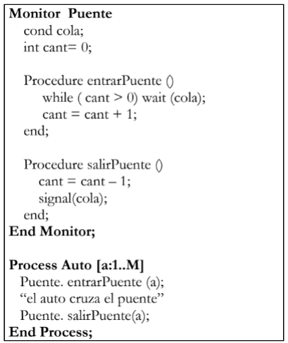

**Programación Concurrente ATIC**
**Práctica 3 – Monitores**

**CONSIDERACIONES PARA RESOLVER LOS EJERCICIOS:**
- Los monitores utilizan el protocolo signal and continue.
- A una variable condition SÓLO pueden aplicársele las operaciones SIGNAL, SIGNALALL y WAIT.
- NO puede utilizarse el wait con prioridades.
- NO se puede utilizar ninguna operación que determine la cantidad de procesos encolados en una variable condition o si está vacía.
- La única forma de comunicar datos entre monitores o entre un proceso y un monitor es por medio de invocaciones al procedimiento del monitor del cual se quieren obtener (o enviar) los datos.
- No existen variables globales.
- En todos los ejercicios debe maximizarse la concurrencia.
- En todos los ejercicios debe aprovecharse al máximo la característica de exclusión mutua que brindan los monitores.
- Debe evitarse hacer busy waiting.
- En todos los ejercicios el tiempo debe representarse con la función delay.

**1. Se dispone de un puente por el cual puede pasar un solo auto a la vez. Un auto pide permiso para pasar por el puente, cruza por el mismo y luego sigue su camino.**



**a. ¿El código funciona correctamente? Justifique su respuesta.**

no. auto le manda a los procesos de puente su id como parámetro, pero los procesos no piden parámetros.

**b. ¿Se podría simplificar el programa? ¿Sin monitor? ¿Menos procedimientos? ¿Sin variable condition? En caso afirmativo, rescriba el código.**

```pseudocode
sem pasar = 1;

Process Auto[a: 1..M] {
    P(pasar);
    // pasa el auto
    V(pasar);
}
```

**c. ¿La solución original respeta el orden de llegada de los vehículos? Si rescribió el código en el punto b), ¿esa solución respeta el orden de llegada?**

no, la disciplina signal and continue determina que el proceso despertado no ejecuta inmediatamente. en su lugar, pasa a la cola de entrada del monitor a competir nuevamente por adquirir la exclusión mutua.

en la solución de b), tampoco se respeta un orden de llegada.

**2. Existen N procesos que deben leer información de una base de datos, la cual es administrada por un motor que admite una cantidad limitada de consultas simultáneas.**

**a. Analice el problema y defina qué procesos, recursos y monitores serán necesarios/convenientes, además de las posibles sincronizaciones requeridas para resolver el problema.**

necesito…

- un monitor con:
  - un contador de lugares libres en la BD;
  - una variable cond que regule la espera si la BD está llena;
  - dos procesos que se encarguen de pedir y liberar el acceso a la BD.
- un proceso que represente los lectores de la BD.

**b. Implemente el acceso a la base por parte de los procesos, sabiendo que el motor de base de datos puede atender a lo sumo 5 consultas de lectura simultáneas.**

```pseudocode
Monitor MotorBD {
    int libres = 5;
    cond espera;

    Procedure pedir_acceso() {
        while (libres == 0) wait(espera);
        libres--;
    }

    Procedure liberar_acceso() {
        libres++;
        signal(espera);
    }
}

Process Proceso[id: 1..N] {
    while (true) {
        MotorBD.pedir_acceso();
        // lee BD
        MotorBD.liberar_acceso();
    }
}
```

**3. Existen N personas que deben fotocopiar un documento. La fotocopiadora sólo puede ser usada por una persona a la vez. Analice el problema y defina qué procesos, recursos y monitores serán necesarios/convenientes, además de las posibles sincronizaciones requeridas para resolver el problema. Luego, resuelva considerando las siguientes situaciones:**

**a. Implemente una solución suponiendo no importa el orden de uso. Existe una función *Fotocopiar()* que simula el uso de la fotocopiadora.**

```pseudocode
Monitor Fotocopiadora {
    Procedure usar() {
        Fotocopiar();
    }
}

Process Persona[id: 1..N] {
    Fotocopiadora.usar();
}
```

**b. Modifique la solución de (a) para el caso en que se deba respetar el orden de llegada.**

```pseudocode
Monitor Admin_Fotocopiadora {
    cond cola;
    boolean libre = true;
    int esperando = 0;

    Procedure solicitar() {
        if (not libre) {
            esperando++;
            wait(cola);
        } else {
            libre = false;
        }
    }

    Procedure liberar() {
        if (esperando > 0) {
            esperando--;
            signal(cola);
        } else {
            libre = true;
        }
    }
}

Process Persona[id: 1..N] {
    Admin_Fotocopiadora.solicitar();
    Fotocopiar();
    Admin_Fotocopiadora.liberar();
}
```

**c. Modifique la solución de (a) para el caso en que se deba dar prioridad de acuerdo con la edad de cada persona (cuando la fotocopiadora está libre la debe usar la persona de mayor edad entre las que estén esperando para usarla).**

```pseudocode
Monitor Admin_Fotocopiadora {
    cond espera[N];
    ColaOrdenada fila;
    boolean libre = true;
    int idAux;

    Procedure solicitar(id, edad: in int) {
        if (not libre) {
            insertar(fila, edad, id);
            wait(espera[id]);
        } else {
            libre = false;
        }
    }

    Procedure liberar() {
        if (not empty(fila)) {
            sacar(fila, idAux);
            signal(espera[idAux]);
        } else {
            libre = true;
        }
    }
}

Process Persona[id: 1..N] {
    int edad = ...;
    Admin_Fotocopiadora.solicitar(id, edad);
    Fotocopiar();
    Admin_Fotocopiadora.liberar();
}
```

**d. Modifique la solución de (a) para el caso en que se deba respetar estrictamente el orden dado por el identificador del proceso (la persona X no puede usar la fotocopiadora hasta que no haya terminado de usarla la persona X-1).**

```pseudocode
Monitor Admin_Fotocopiadora {
    int siguiente = 1;
    cond cola[N+1];

    Procedure solicitar(id: in int) {
        if (siguiente != id) wait(cola[id]);
    }

    Procedure liberar() {
        siguiente++;
        signal(cola[siguiente]);
    }
}

Process Persona[id: 1..N] {
    Admin_Fotocopiadora.solicitar(id);
    Fotocopiar();
    Admin_Fotocopiadora.liberar();
}
```

**e. Modifique la solución de (b) para el caso en que además haya un Empleado que le indica a cada persona cuando debe usar la fotocopiadora.**

```pseudocode
Monitor Admin_Fotocopiadora {
    boolean libre = true;
    cond empleado;
    cond espera;
    int esperando = 0;

    Procedure solicitar() {
        esperando++;
        signal(empleado);
        wait(espera);
    }

    Procedure dar_permiso() {
        while ((esperando == 0) || (not libre)) {
            wait(empleado);
        }
        esperando--;
        libre = false;
        signal(espera);
    }

    Procedure liberar() {
        libre = true;
        if (esperando > 0) {
            signal(empleado);
        }
    }
}

Process Persona[id: 1..N] {
    Admin_Fotocopiadora.solicitar();
    Fotocopiar();
    Admin_Fotocopiadora.liberar();
}

Process Empleado {
    while (true) {
        Admin_Fotocopiadora.dar_permiso();
    }
}
```

**f. Modificar la solución (e) para el caso en que sean 10 fotocopiadoras. El empleado le indica a la persona cuál fotocopiadora usar y cuándo hacerlo.**

```pseudocode
Monitor Admin_Fotocopiadora {
    cond empleado;
    cond espera[N+1];
    cola fila_personas;
    cola libres;
    int asignada[N+1];
    for int idF: 1..10 { push(libres, idF); }

    Procedure solicitar(id: in int; idF: out int) {
        push(fila_personas, id);
        signal(empleado);
        wait(espera[id]);
        idF = asignada[id];
    }

    Procedure dar_permiso() {
        while ((empty(fila_personas)) || empty(libres)) {
            wait(empleado);
        }
        int idP, idF;
        pop(fila_personas, idP);
        pop(libres, idF);
        asignadas[idP] = idF;
        signal(espera[idP]);
    }

    Procedure liberar(idF: in int) {
        push(libres, idF);
        signal(empleado);
    }
}

Process Persona[id: 1..N] {
    int idF;
    Admin_Fotocopiadora.solicitar(id, idF);
    Fotocopiar(idF);
    Admin_Fotocopiadora.liberar(idF);
}

Process Empleado {
    while (true) {
        Admin_Fotocopiadora.dar_permiso();
    }
}
```

**4. En un corralón de materiales se deben atender a N clientes de acuerdo con el orden de llegada. Cuando un cliente es llamado para ser atendido, entrega una lista con los productos que comprará, y espera a que alguno de los empleados le entregue el comprobante de la compra realizada.**

**a. Implemente una solución considerando que el corralón tiene un único empleado y cada cliente hace un único pedido. El empleado debe terminar su ejecución.**

```pseudocode
Monitor Corralon {
    cola clientes;
    cond empleado;
    cond espera[N+1];
    int pedidos[N+1];
    int comprobantes[N+1];

    Procedure entrar(id: in int; pedido: in int; comp: out int) {
        push(clientes, id);
        pedidos[id] = pedido;
        signal(empleado);
        wait(espera[id]);
        comp = comprobantes[id];
    }

    Procedure siguiente(idAct: out int; pedido: out int) {
        while (empty(clientes)) {
            wait(empleado);
        }
        pop(clientes, idAct);
        pedido = pedidos[idAct];
    }

    Procedure entregar(idAct: in int; comprobante: in int) {
        comprobantes[idAct] = comprobante;
        signal(espera[idAct]);
    }
}

Process Cliente[id: 1..N] {
    int pedido = ...;
    int comprobante;
    Corralon.entrar(id, pedido, comprobante);
}

Process Empleado {
    int restantes = N;
    int idAct;
    int pedido;
    int comprobante;
    while (restantes > 0) {
        Corralon.siguiente(idAct, pedido);
        delay(tiempo);
        comprobante = ...;
        Corralon.entregar(idAct, comprobante);
        restantes--;
    }
}
```

**b. Implemente una solución considerando que el corralón tiene E empleados (E > 1). Los empleados no deben terminar su ejecución.**

```pseudocode
Monitor Corralon {
    cola clientes;
    cond empleados;
    cond condClientes[N+1];
    int pedidos[N+1];
    int comprobantes[N+1];

    Procedure entrar(id: in int; pedido: in int; comp: out int) {
        push(clientes, id);
        pedidos[id] = pedido;
        signal(empleados);
        wait(condClientes[id]);
        comp = comprobantes[id];
    }

    Procedure siguiente(idAct: out int; pedido: out int) {
        while (empty(clientes)) {
            wait(empleados);
        }
        pop(clientes, idAct);
        pedido = pedidos[idAct];
    }

    Procedure entregar(idAct: in int; comprobante: in int) {
        comprobantes[idAct] = comprobante;
        signal(condClientes[idAct]);
    }
}

Process Cliente[id: 1..N] {
    int pedido = ...;
    int comprobante;
    Corralon.entrar(id, pedido, comprobante);
}

Process Empleado[id: 1..E] {
    int idAct;
    int pedido;
    int comprobante;
    while (true) {
        Corralon.siguiente(idAct, pedido);
        delay(tiempo);
        comprobante = ...;
        Corralon.entregar(idAct, comprobante);
    }
}
```

**c. Modifique la solución (b) considerando que los empleados deben terminar su ejecución cuando se hayan atendido todos los clientes (cada cliente hace un único pedido).**

```pseudocode
Monitor Corralon {
    cola clientes;
    cond empleados;
    cond condClientes[N+1];
    int pedidos[N+1];
    int comprobantes[N+1];
    int restantes = N;

    Procedure entrar(id: in int; pedido: in int; comp: out int) {
        push(clientes, id);
        pedidos[id] = pedido;
        signal(empleados);
        wait(condClientes[id]);
        comp = comprobantes[id];
    }

    Procedure siguiente(idAct: out int; pedido: out int; seguir: out boolean) {
        while (empty(clientes) && restantes > 0) {
            wait(empleados);
        }
        if (restantes > 0) {
            pop(clientes, idAct);
            pedido = pedidos[idAct];
            seguir = true;
        } else {
            seguir = false;
        }
    }

    Procedure entregar(idAct: in int; comprobante: in int) {
        comprobantes[idAct] = comprobante;
        signal(condClientes[idAct]);
        restantes--;
        if (restantes == 0) {
            signal_all(empleados);
        }
    }
}

Process Cliente[id: 1..N] {
    int pedido = ...;
    int comprobante;
    Corralon.entrar(id, pedido, comprobante);
}

Process Empleado[id: 1..E] {
    int idAct;
    int pedido;
    int comprobante;
    boolean seguir = true;
    while (seguir) {
        Corralon.siguiente(idAct, pedido, seguir);
        if (seguir) {
            delay(tiempo);
            comprobante = ...;
            Corralon.entregar(idAct, comprobante);
        }
    }
}
```

**5. Existe una comisión de 50 alumnos que deben realizar tareas de a pares, las cuales son corregidas por un JTP. Cuando los alumnos llegan, forman una fila. Una vez que están todos en fila, el JTP les asigna un número de grupo a cada uno. Para ello, suponga que existe una función *AsignarNroGrupo()* que retorna un número "aleatorio" del 1 al 25. Cuando un alumno ha recibido su número de grupo, comienza a realizar su tarea. Al terminarla, el alumno le avisa al JTP y espera por su nota. Cuando los dos alumnos del grupo completaron la tarea, el JTP les asigna un puntaje (el primer grupo en terminar tendrá como nota 25, el segundo 24, y así sucesivamente hasta el último que tendrá nota 1). Nota: el JTP no guarda el número de grupo que le asigna a cada alumno.**

```pseudocode
Monitor Aula {
    cond fila[50];
    cond jtp;
    Cola fila_alumnos;
    int grupos[50];
    int entregas_por_grupo ([25] 0);
    Cola entregas;
    cond fila_notas[25];
    double puntajes[25];

    Procedure pedir_grupo(id: in int; grupo: out int) {
        fila_alumnos.push(id);
        signal(jtp);
        wait(fila[id]);
        grupo = grupos[id];
    }

    Procedure asignar_grupos() {
        while (size(fila_alumnos) < 50) {
            wait(jtp);
        }
        for int i = 0..49: {
            grupos[i] = AsignarNroGrupo() - 1;
            signal(fila[i]);
        }
    }

    Procedure esperar_nota(grupo: in int; nota: out double) {
        entregas.push(grupo);
        entregas_por_grupo[grupo]++;
        signal(jtp);
        wait(fila_notas[grupo]);
        nota = puntajes[grupo];
    }

    Procedure corregir() {
        int grupo;
        int notaAct = 25;
        for int i = 0..49 {
            while (empty(entregas)) {
                wait(jtp);
            }
            grupo = entregas.pop();
            if (entregas_por_grupo[grupo] == 2) {
                puntajes[grupo] = notaAct;
                notaAct--;
                signal_all(fila_notas[grupo]);
            }
        }
    }
}

Process Alumno[id: 0..49] {
    int grupo;
    double nota;
    Aula.pedir_grupo(id, grupo);
    // haciendo examen
    Aula.esperar_nota(grupo, nota);
}

Process JTP {
    Aula.asignar_grupos();
    Aula.corregir();
}
```

**6. En un entrenamiento de fútbol hay 20 jugadores que forman 4 equipos (cada jugador conoce el equipo al cual pertenece llamando a la función *DarEquipo()*). Cuando un equipo está listo (han llegado los 5 jugadores que lo componen), debe enfrentarse a otro equipo que también esté listo (los dos primeros equipos en juntarse juegan en la cancha 1, y los otros dos equipos juegan en la cancha 2). Una vez que el equipo conoce la cancha en la que juega, sus jugadores se dirigen a ella. Cuando los 10 jugadores del partido llegaron a la cancha comienza el partido, juegan durante 50 minutos, y al terminar todos los jugadores del partido se retiran (no es necesario que se esperen para salir).**

**7. Se debe simular una maratón con C corredores donde en la llegada hay UNA máquina expendedoras de agua con capacidad para 20 botellas. Además, existe un repositor encargado de reponer las botellas de la máquina. Cuando los C corredores han llegado al inicio comienza la carrera. Cuando un corredor termina la carrera se dirigen a la máquina expendedora, espera su turno (respetando el orden de llegada), saca una botella y se retira. Si encuentra la máquina sin botellas, le avisa al repositor para que cargue nuevamente la máquina con 20 botellas; espera a que se haga la recarga; saca una botella y se retira. Nota: mientras se reponen las botellas se debe permitir que otros corredores se encolen.**

```pseudocode
Monitor Maraton {
    boolean libre = true;
    cond espera_inicio;
    cond espera_botellas;
    int corredores = 0;
    int esperando = 0;

    Procedure llegue() {
        corredores++;
        if (corredores == C) {
            signal_all(espera_inicio);
        } else {
            wait(espera_inicio);
        }
    }

    Procedure acceder_maquina() {
        if (libre) {
            libre = false;
        } else {
            esperando++;
            wait(espera_botellas);
        }
    }

    Procedure liberar_maquina() {
        if (esperando > 0) {
            esperando--;
            signal(espera_botellas);
        } else {
            libre = true;
        }
    }
}

Monitor Maquina {
    cond repo, espera_repo;
    int botellas = 20;

    Procedure reponer_agua() {
        if (botellas > 0) {
            wait(repo);
        }
        botellas = 20;
        signal(espera_repo);
    }

    Procedure usar() {
        if (botellas == 0) {
            signal(repo);
            wait(espera_repo);
        }
        botellas--;
    }
}

Process Corredor[id: 0..C-1] {
    Maraton.llegue();
    // corriendo
    Maraton.acceder_maquina();
    Maquina.usar();
    Maraton.liberar_maquina();
}

Process Repositor {
    while (true) {
        Maquina.reponer_agua();
    }
}
```

**8. En un examen de la secundaria hay *un preceptor* y *una profesora* que deben tomar un examen escrito a *45 alumnos*. El preceptor se encarga de darle el enunciado del examen a los alumnos cundo los 45 han llegado (es el mismo enunciado para todos). La profesora se encarga de ir corrigiendo los exámenes de acuerdo con el orden en que los alumnos van entregando. Cada alumno al llegar espera a que le den el enunciado, resuelve el examen, y al terminar lo deja para que la profesora lo corrija y le envíe la nota. Nota: maximizar la concurrencia; todos los procesos deben terminar su ejecución; suponga que la profesora tiene una función *corregirExamen* que recibe un examen y devuelve un entero con la nota.**

```pseudocode
Monitor Aula {
    int cantAlumnos = 0;
    cond espera_enunciado, preceptor;
    cond espera_notas = [45];
    int notas[45];
    text enunciado;
    Cola examenes;
    cond profe;

    Procedure entrar(enun: out text) {
        cantAlumnos++;
        if (cantAlumnos == 45) {
            signal(preceptor);
        }
        wait(espera_enunciado);
        enun = enunciado;
    }

    Procedure esperar_alumnos(enun: in text) {
        if (cantAlumnos < 45) {
            wait(preceptor);
        }
        enunciado = enun;
        signal_all(espera_enunciado);
    }

    Procedure entregar(id: in int; examen: in text; nota: out int) {
        push(examenes, id, examen);
        signal(profe);
        wait(espera_notas[id]);
        nota = notas[id];
    }

    Procedure esperar_examen(id: out int; examen: out text) {
        if (empty examenes) {
            wait(profe);
        }
        pop(examenes, id, examen);
    }

    Procedure entregar_nota(id: in int; nota: in int) {
        notas[id] = nota;
        signal(espera_notas[id]);
    }
}

Process Alumno[id: 0..44] {
    text enunciado;
    int nota;
    Aula.entrar(id, enunciado);
    text examen = Resolver(enunciado);
    Aula.entregar(examen, nota);
}

Process Preceptor {
    text enunciado = …;
    Aula.esperar_alumnos(enunciado);
}

Process Profesora {
    int i, nota, idAct;
    text examen;
    for i = 0..44 {
        Aula.esperar_examen(idAct, examen);
        nota = corregirExamen(examen);
        Aula.entregar_nota(idAct, nota);
    }
}
```
