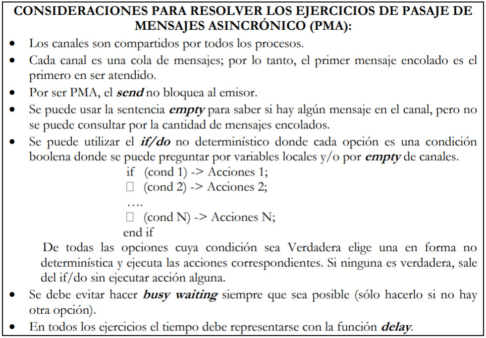
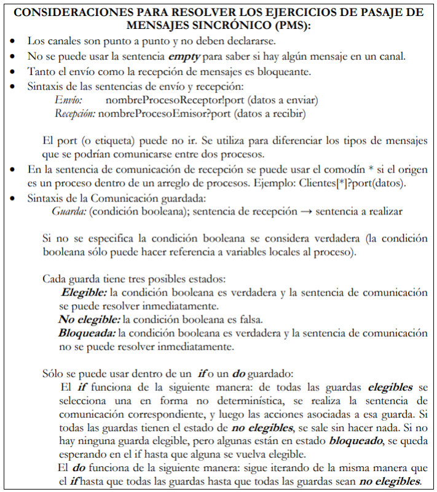

**Programación Concurrente ATIC**

**Práctica 4 – Pasaje de Mensajes**



**1. Suponga que N clientes llegan a la cola de un banco y que serán atendidos por sus empleados. Analice el problema y defina qué procesos, recursos y comunicaciones serán necesarios/convenientes para resolver el problema. Luego, resuelva considerando las siguientes situaciones:**

**a. Existe un único empleado, el cual atiende por orden de llegada.**

```pseudocode
chan Cola(int)
chan Espera[N](boolean)

Process Cliente[id: 0..N-1] {
    boolean pasar;
    send Cola(id);
    receive Espera[id](pasar);
}

Process Empleado {
    int idAux;
    while (true) {
        receive Cola(idAux);
        resolver_pedido();
        send Espera[idAux](true);
    }
}
```

**b. Ídem a) pero considerando que hay 2 empleados para atender, ¿qué debe modificarse en la solución anterior?**

```pseudocode
chan Cola(int)
chan Espera[N](boolean)

Process Cliente[id: 0..N-1] {
    boolean pasar;
    send Cola(id);
    receive Espera[id](pasar);
}

Process Empleado[id: 0..1] {
    int idAux;
    while (true) {
        receive Cola(idAux);
        resolver_pedido();
        send Espera[idAux](true);
    }
}
```

**c. Ídem b) pero considerando que, si no hay clientes para atender, los empleados realizan tareas administrativas durante 15 minutos. ¿Se puede resolver sin usar procesos adicionales? ¿Qué consecuencias implicaría?**

```pseudocode
chan Cola(int);
chan Espera[N](boolean);
chan Pedido(int);
chan Siguiente[4](int);

Process Cliente[id: 0..N-1] {
    boolean pasar;
    send Cola(id);
    receive Espera[id](pasar);
}

Process Coordinador {
    int idEmp, idCli;
    while (true) {
        receive Pedido(idEmp);
        if (empty(Cola)) {
            idCli = -1;
        } else {
            receive Cola(idCli);
        }
        send Siguiente[idEmp](idCli);
    }
}

Process Empleado[id: 0..1] {
    int idAux;
    while (true) {
        send Pedido(id);
        receive Siguiente[id](idAux);
        if (idAux != -1) {
            resolver_pedido();
            send Espera[idAux](true);
        } else {
            delay(15);
        }
    }
}
```

**2. Se desea modelar el funcionamiento de un banco en el cual existen 5 cajas para realizar pagos. Existen P clientes que desean hacer un pago. Para esto, cada una selecciona la caja donde hay menos personas esperando; una vez seleccionada, espera a ser atendido. En cada caja, los clientes son atendidos por orden de llegada por los cajeros. Luego del pago, se les entrega un comprobante. Nota: maximizando la concurrencia.**

```pseudocode
chan cajas[5](int, text);
chan llegada(int, int);
chan asignacion[P](int);
chan comprobantes[P](text);

Process Cliente[id: 0..P-1] {
    int miCaja;
    text miComprobante;
    text miPago = ...;

    send llegada(0, id);
    receive asignacion[id](miCaja);
    send cajas[miCaja](id, miPago);
    receive comprobantes[id](miComprobante);
}

Process Caja[id: 0..4] {
    text pago, comprobante;
    int idAct;
    while (true) {
        receive cajas[id](idAct, pago);
        comprobante = ...;
        send comprobantes[idAct](comprobante);
        send llegada(-1, id);
    }
}

Process Coordinador {
    int cantXCaja[5] = ([5] 0);
    int i, j, cajaMin;
    int idAct, tipoAct;
    while (true) {
        int min = 9999;
        receive llegada(tipoAct, idAct);
        if (tipoAct == -1) {
            cantXCaja[idAct]--;
        } else {
            for j = 0..4 {
                if (cantXCaja[j] < min) {
                    min = cantXCaja[j];
                    cajaMin = j;
                }
            }
            cantXCaja[cajaMin]++;
            send asignacion[idAct](cajaMin);
        }
    }
}
```

**3. Se debe modelar el funcionamiento de una casa de comida rápida, en la cual trabajan 2 cocineros y 3 vendedores, y que debe atender a C clientes. El modelado debe considerar que:**

- Cada cliente realiza un pedido y luego espera a que se lo entreguen.
- Los pedidos que hacen los clientes son tomados por cualquiera de los vendedores y se lo pasan a los cocineros para que realicen el plato. Cuando no hay pedidos para atender, los vendedores aprovechan para reponer un pack de bebidas de la heladera (tardan entre 1 y 3 minutos para hacer esto).
- Repetidamente cada cocinero toma un pedido pendiente dejado por los vendedores, lo cocina y se lo entrega directamente al cliente correspondiente.

**Nota: maximizar la concurrencia.**

```pseudocode
chan pedidos(int, text);
chan platos[C](text);
chan consultas(int);
chan siguiente[3](int, text);
chan cocina(int, text);

Process Cliente[id: 0..C-1] {
    text miPedido = ...;
    text miPlato;
    send pedidos(id, miPedido);
    receive platos[id](miPlato);
}

Process Cocinero[id: 0..1] {
    int idAct;
    text pedidoAct, plato;
    while (true) {
        receive cocina(idAct, pedidoAct);
        // cocinando plato
        plato = ...;
        send platos[idAct](plato);
    }
}

Process Vendedor[id: 0..2] {
    int idAct;
    text pedidoAct;
    while (true) {
        send consultas(id);
        receive siguiente[id](idAct, pedidoAct);
        if (pedidoAct == "VACIO") {
            delay(reponer);
        } else {
            send cocina(idAct, pedidoAct);
        }
    }
}

Process Coordinador {
    int idAct; int idCli;
    text pedidoAct;
    while (true) {
        receive consultas(idAct);
        if (empty(pedidos)) {
            send siguiente[idAct](0, "VACIO");
        } else {
            receive pedidos(idCli, pedidoAct);
            send siguiente[idAct](idCli, pedidoAct);
        }
    }
}
```

**4. Simular la atención en un locutorio con 10 cabinas telefónicas, el cual tiene un empleado que se encarga de atender a N clientes. Al llegar, cada cliente espera hasta que el empleado le indique a qué cabina ir, la usa y luego se dirige al empleado para pagarle. El empleado atiende a los clientes en el orden en que hacen los pedidos, pero siempre dando prioridad a los que terminaron de usar la cabina. A cada cliente se le entrega un ticket factura por la operación.**

**a) Implemente una solución para el problema descrito.**

**b) Modifique la solución implementada para que el empleado dé prioridad a los que terminaron de usar la cabina sobre los que están esperando para usarla.**

**Nota: maximizar la concurrencia; suponga que hay una función *Cobrar()* llamada por el empleado que simula que el empleado le cobra al cliente.**

```pseudocode
chan llegadas(int);
chan queCabina[N](int);
chan aviso(int);

Process Cliente[id: 0..N-1] {
    int cabina;
    text miTicket;
    send llegadas(id);
    send aviso(1);
    receive queCabina[id](cabina);
    // usando cabina
    send pagos(id, miCabina)
    send aviso(1);
    receive tickets[id](miTicket);
}

Process Empleado {
    int libres = 10;
    int i, señal, idAct, cabinaAct;
    text ticket;
    cola cabinasLibres;
    cola filaEspera;

    for i = 1..10 {
        push(cabinasLibres, i);
    }

    while (true) {
        receive aviso(señal);
        if (not empty(pagos)) {
            receive pagos(idAct, cabinaAct);
            push(cabinasLibres, cabinaAct);
            libres++;
            ticket = Cobrar();
            send tickets[idAct](ticket);
        } else {
            receive llegadas(idAct);
            push(filaEspera, idAct);
        }
        while (not empty(filaEspera)) and (libres > 0) {
            libres--;
            pop(filaEspera, idAct);
            pop(cabinasLibres, cabinaAct);
            send queCabina[idAct](cabinaAct);
        }
    }
}
```

**5. Resolver la administración de 3 impresoras de una oficina. Las impresoras son usadas por N administrativos, los cuales están continuamente trabajando y cada tanto envían documentos a imprimir. Cada impresora, cuando está libre, toma un documento y lo imprime, de acuerdo con el orden de llegada.**

**a) Implemente una solución para el problema descrito.**

**b) Modifique la solución implementada para que considere la presencia de un director de oficina que también usa las impresoras, el cual tiene prioridad sobre los administrativos.**

**c) Modifique la solución (a) considerando que cada administrativo imprime 10 trabajos y que todos los procesos deben terminar su ejecución.**

**d) Modifique la solución (b) considerando que tanto el director como cada administrativo imprimen 10 trabajos y que todos los procesos deben terminar su ejecución.**

**e) Si la solución al ítem d) implica realizar *Busy Waiting*, modifíquela para evitarlo.**

**Nota: ni los administrativos ni el director deben esperar a que se imprima el documento.**

**b)**

```pseudocode
chan pedidosAdmin(text);
chan pedidosDirector(text);
chan aviso(int);
chan libres(int);
chan siguiente[3](text);

Process Admin[id: 0..N-1] {
    text pedidoAct;
    while (true) {
        pedidoAct = ...;
        send pedidosAdmin(pedidoAct);
        send aviso(1);
    }
}

Process Director {
    text pedidoAct;
    while (true) {
        pedidoAct = ...;
        send pedidosDirector(pedidoAct);
        send aviso(1);
    }
}

Process Coordinador {
    int signal, impAct;
    text pedidoAct;
    while (true) {
        receive libres(impAct);
        receive aviso(signal);
        if (not empty pedidosDirector) {
            receive pedidosDirector(pedidoAct);
        } else {
            receive pedidosAdmin(pedidoAct);
        }
        send siguiente[impAct](pedidoAct);
    }
}

Process Impresora[id: 0..2] {
    text pedidoAct;
    while (true) {
        send libres(id);
        receive siguiente[id](pedidoAct);
        delay(imprimiendo);
    }
}
```

**c)**

```pseudocode
chan pedidos(text);
chan fin(int);

Process Admin[id: 0..N-1] {
    text pedidoAct;
    int i;
    for i = 1..10 {
        pedidoAct = ...;
        send pedidos(documento);
    }
    send fin(id);
}

Process Coordinador {
    int i, idAux;
    for i = 1..N {
        receive fin(idAux);
    }
    for i = 1..3 {
        send pedidos("FIN");
    }
}

Process Impresora[id: 0..2] {
    text pedidoAct;
    boolean continuar = true;
    while (continuar) {
        receive pedidos(pedidoAct);
        if (pedidoAct == "FIN") {
            continuar = false;
        } else {
            delay(imprimiendo);
        }
    }
}
```

**d)**

```pseudocode
chan pedidosAdmin(text);
chan pedidosDirector(text);
chan aviso(int);
chan libres(int);
chan siguiente[3](text);

Process Admin[id: 0..N-1] {
    text pedidoAct;
    int i;
    for i = 1..10 {
        pedidoAct = ...;
        send pedidosAdmin(pedidoAct);
        send aviso(1);
    }
    send fin(id);
}

Process Director {
    text pedidoAct;
    int i;
    for i = 1..10 {
        pedidoAct = ...;
        send pedidosDirector(pedidoAct);
        send aviso(1);
    }
    send fin(id);
}

Process CoordiFin {
    int i;
    int idAux;
    for i = 1..N+1 {
        receive fin(idAux);
    }
    for i = 1..3 {
        send pedidosAdmin("FIN");
    }
}

Process Coordinador {
    int signal, impAct, i;
    text pedidoAct;
    boolean finAdmin, finDir = false;
    int impresorasApagadas = 0;
    while (impresorasApagadas < 3) {
        receive libres(impAct);
        receive aviso(signal);
        if (not empty pedidosDirector) {
            receive pedidosDirector(pedidoAct);
        } else {
            receive pedidosAdmin(pedidoAct);
        }
        send siguiente[impAct](pedidoAct);
        if (pedidoAct == "FIN") impresorasApagadas++;
    }
}

Process Impresora[id: 0..2] {
    text pedidoAct;
    boolean continuar = true;
    while (continuar) {
        send libres(id);
        receive siguiente[id](pedidoAct);
        if (pedidoAct != "FIN") {
            delay(imprimiendo);
        } else {
            continuar = false;
        }
    }
}
```



**1. Suponga que existe un antivirus distribuido que se compone de R procesos robots Examinadores y 1 proceso Analizador. Los procesos Examinadores están buscando continuamente posibles sitios web infectados; cada vez que encuentran uno avisan la dirección y luego continúan buscando. El proceso Analizador se encarga de hacer todas las pruebas necesarias con cada uno de los sitios encontrados por los robots para determinar si están o no infectados.**

**a) Analice el problema y defina qué procesos, recursos y comunicaciones serán necesarios/convenientes para resolver el problema.**

r procesos Examinador, 1 proceso Analizador

**b) Implemente una solución con PMS sin tener en cuenta el orden de los pedidos.**

```pseudocode
Process Examinador[id: 0..R-1] {
    text sitio, resultado;
    while (true) {
        sitio = getSitio();
        Analizador!consulta(sitio);
    }
}

Process Analizador {
    text sitio, resultado;
    int idAct;
    while (true) {
        Examinador[*]?consulta(sitio);
        resultado = analizar(sitio);
    }
}
```

**c) Modifique el inciso (b) para que el Analizador resuelva los pedidos en el orden en que se hicieron.**

```pseudocode
Process Examinador[id: 0..R-1] {
    text sitio, resultado;
    while (true) {
        sitio = getSitio();
        Coordinador!consulta(sitio);
    }
}

Process Coordinador {
    text sitio;
    cola colaSitios;
    do Examinador[*]?consulta(sitio) → push(colaSitios, sitio);
    [] not empty(colaSitios); Analizador?pedido() →
        pop(colaSitios, sitio);
        Analizador!entregar(sitio);
    od
}

Process Analizador {
    text sitio;
    while (true) {
        Coordinador!pedido();
        Coordinador?entregar(sitio);
        analizar(sitio);
    }
}
```

**2. En un laboratorio de genética veterinaria hay 3 empleados. El primero de ellos continuamente prepara las muestras de ADN; cada vez que termina, se la envía al segundo empleado y vuelve a su trabajo. El segundo empleado toma cada muestra de ADN preparada, arma el set de análisis que se deben realizar con ella y espera el resultado para archivarlo. Por último, el tercer empleado se encarga de realizar el análisis y devolverle el resultado al segundo empleado.**

```pseudocode
Process Empleado1 {
    text muestra;
    while (true) {
        prepararMuestra(muestra);
        CoordiMuestra!muestras(muestra);
    }
}

Process CoordiMuestras {
    text muestra;
    cola c;
    do Empleado1?muestras(muestra); → push(c, muestra);
    [] not empty(c); Empleado2?pedido(); →
        pop(c, muestra);
        Empleado2!entregar(muestra);
    od
}

Process Empleado2 {
    text muestra, set, resultado;
    while (true) {
        CoordiMuestras!pedido();
        CoordiMuestras?entregar(muestra);
        set = armarSet(muestra);
        Empleado3!analisis(set);
        Empleado3?resultadoAnalisis(resultado);
        archivar(resultado);
    }
}

Process Empleado3 {
    text set, resultado;
    while (true) {
        Empleado2?analisis(set);
        resultado = realizarAnalisis(set);
        Empleado2!resultadoAnalisis(resultado);
    }
}
```

**3. En un examen final hay N alumnos y P profesores. Cada alumno resuelve su examen, lo entrega y espera a que alguno de los profesores lo corrija y le indique la nota. Los profesores corrigen los exámenes respetando el orden en que los alumnos van entregando.**

**a) Implemente una solución con PMS considerando que P=1.**

```pseudocode
Process Alumno[id: 0..N-1] {
    text examen = ...;
    double nota;
    Coordinador!entrega(examen);
    Profesor?devolucion(nota);
}

Process Coordinador {
    int i, idAct;
    text examenAct;
    cola c;
    for i = 1..N {
        do Alumno[*]?entrega(examenAct, idAct); → push(c, (idAct, examenAct));
        [] (not empty(c)); Profesor?pedido(); →
            pop(c, (idAct, examenAct));
            Profesor!corregir(idAct, examenAct);
        od
    }
}

Process Profesor {
    int i, idAct;
    text examenAct;
    double nota;
    for i = 1..N {
        Coordinador!pedido();
        Coordinador?corregir(idAct, examenAct);
        corregir(examenAct, nota);
        Alumno[idAct]!devolucion(nota);
    }
}
```

**b) Implemente una solución con PMS considerando que P>1.**

```pseudocode
Process Alumno[id: 0..N-1] {
    text examen = ...;
    double nota;
    Coordinador!entrega(id, examen);
    Profesor[*]?devolucion(nota);
}

Process Coordinador {
    int i, idAct, idProf;
    text examenAct;
    cola c;
    int recibidos = 0;
    int entregados = 0;

    do (recibidos < N); Alumno[*]?entrega(examenAct, idAct); →
        push(c, (idAct, examenAct));
        recibidos++;
    [] (entregados < N) and (not empty(c)); Profesor[*]?pedido(idProf); →
        pop(c, (idAct, examenAct));
        Profesor[idProf]!corregir(idAct, examenAct);
        entregados++;
    od

    for i = 0..P-1 {
        Profesor[*]?pedido(idProf);
        Profesor[idProf]!corregir(0, "FIN");
    }
}

Process Profesor[id: 0..P-1] {
    int i, idAct;
    text examenAct;
    double nota;
    boolean continuar = true;
    while (continuar) {
        Coordinador!pedido(id);
        Coordinador?corregir(idAct, examenAct);
        if (examenAct == "FIN") {
            continuar = false;
        } else {
            corregir(examenAct, nota);
            Alumno[idAct]!devolucion(nota);
        }
    }
}
```

**c) Modifique (b) considerando que los alumnos no comienzan a realizar su examen hasta que todos hayan llegado al aula. *Nota: maximizar la concurrencia; no generar demora innecesaria; todos los procesos deben terminar su ejecución.***

```pseudocode
Process Alumno[id: 0..N-1] {
    text examen = ...;
    double nota;
    Coordinador!llegue();
    Coordinador?empezar();
    Coordinador!entrega(id, examen);
    Profesor[*]?devolucion(nota);
}

Process Coordinador {
    int i, idAct, idProf;
    text examenAct;
    cola c;
    int recibidos = 0;
    int entregados = 0;

    for i = 0..N-1 {
        Alumno[*]?llegue();
    }

    for i = 0..N-1 {
        Alumno[i]!empezar();
    }

    do (recibidos < N); Alumno[*]?entrega(examenAct, idAct); →
        push(c, (idAct, examenAct));
        recibidos++;
    [] (entregados < N) and (not empty(c)); Profesor[*]?pedido(idProf); →
        pop(c, (idAct, examenAct));
        Profesor[idProf]!corregir(idAct, examenAct);
        entregados++;
    od

    for i = 0..P-1 {
        Profesor[*]?pedido(idProf);
        Profesor[idProf]!corregir(0, "FIN");
    }
}

Process Profesor[id: 0..P-1] {
    int i, idAct;
    text examenAct;
    double nota;
    boolean continuar = true;
    while (continuar) {
        Coordinador!pedido(id);
        Coordinador?corregir(idAct, examenAct);
        if (examenAct == "FIN") {
            continuar = false;
        } else {
            corregir(examenAct, nota);
            Alumno[idAct]!devolucion(nota);
        }
    }
}
```

**4. En una exposición aeronáutica hay un simulador de vuelo (que debe ser usado con exclusión mutua) y un empleado encargado de administrar su uso. Hay P personas que esperan a que el empleado lo deje acceder al simulador, lo usa por un rato y se retira.**

**a) Implemente una solución donde el empleado sólo se ocupa de garantizar la exclusión mutua (sin importar el orden).**

**b) Modifique la solución anterior para que el empleado los deje acceder según el orden de su identificador (hasta que la persona i no lo haya usado, la persona i+1 debe esperar).**

**c) Modifique la solución a) para que el empleado considere el orden de llegada para dar acceso al simulador. *Nota: cada persona usa sólo una vez el simulador.***

**5. En un estadio de fútbol hay una máquina expendedora de gaseosas que debe ser usada por E Espectadores de acuerdo al orden de llegada. Cuando el espectador accede a la máquina en su turno usa la máquina y luego se retira para dejar al siguiente. *Nota: cada Espectador una sólo una vez la máquina.***
